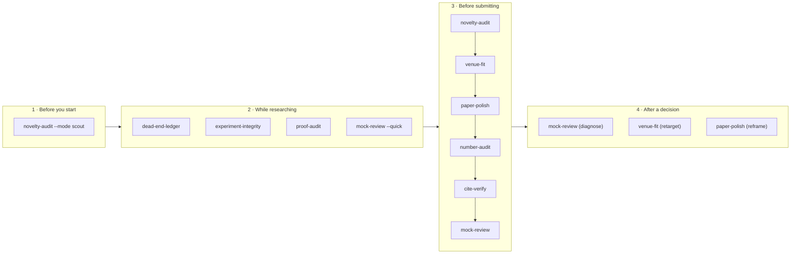
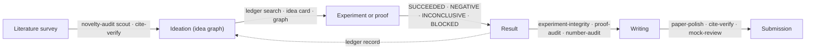

<div align="center">

# Science-Skill

**Claude Code skills that catch the predictable mistakes of AI-assisted research, before an editor or a referee does.**

[](https://github.com/OIerYangJZ/Science-Skill/actions/workflows/tests.yml)
[](LICENSE)


**English** · [简体中文](README.zh-CN.md)

[Quick start](#quick-start) · [What it catches](#what-it-catches) · [Case study](#case-study) · [Skills](#skills-at-a-glance) · [Skill guide](#skill-guide) · [Pipelines](#using-the-skills-as-gates-in-automated-research-pipelines) · [FAQ](#faq)

</div>

---

## Why this exists

AI assistants are now part of how research gets written, analyzed and checked. They fail in ways that are predictable, and each failure has a cost: a desk rejection, a wrong number in print, a fabricated reference, months spent on an idea that was already published.

| When an AI assistant… | …this tends to go wrong | Skill |
|---|---|---|
| polishes a manuscript | it hedges until the contribution disappears, or overclaims when asked to be bolder | [`paper-polish`](#paper-polish) |
| moves numbers between data, code and text | numbers drift from the data; statistics stop adding up | [`number-audit`](#number-audit) |
| writes and edits analysis code | the code no longer implements the design the paper describes; the evaluation manufactures the result | [`experiment-integrity`](#experiment-integrity) |
| writes or polishes long proofs | steps are never written out or checked; a solver's answer is taken as proof of the formula fed to it | [`proof-audit`](#proof-audit) |
| compiles a bibliography | metadata is wrong, references are invented, citations do not support their sentences | [`cite-verify`](#cite-verify) |
| searches the literature | it finds what confirms novelty and misses what refutes it | [`novelty-audit`](#novelty-audit) |
| suggests where to submit | it answers from memory; fees, rules and deadlines are out of date | [`venue-fit`](#venue-fit) |
| writes a mock review | it echoes the authors' notes, and its "errors" are never verified | [`mock-review`](#mock-review) |
| reports progress on a hard problem | it is more optimistic than the evidence and retries routes that already failed | [`dead-end-ledger`](#dead-end-ledger) |

Each skill is a **written procedure** that Claude Code follows, backed by **standard-library Python scripts** that measure, trace or verify, so that conclusions rest on evidence rather than on the model's tone. Every skill was written after the corresponding failure occurred in a real project ([FAILURE_MODES.md](FAILURE_MODES.md)).

The skills are **discipline-agnostic**. They read LaTeX, Word, Markdown, plain-text and PDF manuscripts, and they treat theoretical, experimental, observational, computational, qualitative and review studies differently where it matters: evidence levels, reporting guidelines, causal language.

## Contents

- [Why this exists](#why-this-exists)
- [What it catches](#what-it-catches)
- [Case study](#case-study)
- [Quick start](#quick-start)
- [Where the skills fit](#where-the-skills-fit)
- [Skills at a glance](#skills-at-a-glance)
- [Design principles](#design-principles)
- [Installation](#installation)
- [How a skill run works](#how-a-skill-run-works)
- [Skill guide](#skill-guide): [paper-polish](#paper-polish) · [number-audit](#number-audit) · [experiment-integrity](#experiment-integrity) · [proof-audit](#proof-audit) · [cite-verify](#cite-verify) · [novelty-audit](#novelty-audit) · [venue-fit](#venue-fit) · [mock-review](#mock-review) · [dead-end-ledger](#dead-end-ledger)
- [Quick prompts without Claude Code](#quick-prompts-without-claude-code)
- [Using the skills as gates in automated research pipelines](#using-the-skills-as-gates-in-automated-research-pipelines)
- [Command-line tools](#command-line-tools) · [Supported inputs](#supported-inputs) · [Data sources and privacy](#data-sources-and-privacy)
- [Limitations](#limitations) · [FAQ](#faq) · [Related projects](#related-projects)
- [Repository layout](#repository-layout) · [Tests](#tests) · [Contributing](#contributing) · [Citing](#citing) · [License](#license)

## What it catches

Each example below is condensed from real output of the bundled scripts on the synthetic fixtures in [`tests/fixtures/`](tests/fixtures/), except the bibliography check, which ran on a small test file. You can reproduce them in seconds (see [Quick start](#quick-start)).

### A defensive abstract → `paper-polish`

> *Although many methods exist, we attempt to shed light on the problem. It is worth noting that results may potentially vary. We do not claim that the method is general. We first tried a linear model. Then we ran a series of experiments. Our method may not generalize. In some cases the approach is limited.*

```text
$ python3 skills/paper-polish/scripts/hedge_scan.py tests/fixtures/hedge.md
| hedge.md:5 | D2  | Although                  | concession before the result
| hedge.md:5 | D4  | we attempt · shed light   | diluted contribution
| hedge.md:5 | D12 | It is worth noting        | filler
| hedge.md:5 | D5  | may potentially           | modal hedge
| hedge.md:5 | D1  | We do not claim           | disclaimer
| hedge.md:5 | D15 | We first tried · Then we  | work-report narrative
| hedge.md:5 | D16 | may not generalize        | local weakness stated as global
defensive hits / 100 words: 15.66
```

The scan finds only the symptoms. The skill then compares your abstract with recent papers in the target journal and rewrites it from a claim ledger, in this spirit:

| Before | After |
|---|---|
| "Our method may not generalize, and in some cases its accuracy is limited." | "Accuracy holds within 2 points across the four adult cohorts; in the pediatric cohort (n = 212) it drops by 9 points, which we trace to a different age distribution of the main predictor." |

The weakness stays in the paper; it is now precise, and stated where it was observed.

### Statistics that do not add up → `number-audit`

```text
$ python3 skills/number-audit/scripts/number_audit.py stats tests/fixtures/stats.md --out /tmp/demo
12 reported results recognised; 7 need attention.

status        test       reported                                why
INCONSISTENT  t          t(28) = 2.20, p = .004                  recomputed p = 0.036
CHECK         GRIM mean  M = 3.48, SD = 1.20, n = 15             no integer total over n = 15 gives this mean
CHECK         GRIM %     33.3% (n = 28)                          no k/28 rounds to 33.3%
CHECK         SD bound   85.2% ± 60.1%                           SD above the maximum possible (35.5) on [0, 100]
INCONSISTENT  delta      from 200 ms to 150 ms, a 40% reduction  200 → 150 is a 25% reduction
CHECK         overlap    outperforms (81.2 ± 2.1 vs 80.4 ± 1.9)  intervals overlap: report a test
ok            t          t(40) = 2.10, p = .042
```

### Code that manufactures a result → `experiment-integrity`

```python
def run_case(mode, seed, p, rng):
    for k in range(10):
        if mode == "q4" and rng.random() < p:   # draws only in one arm: the random streams desynchronize
            ...

def max_gap(angles):
    if len(angles) < 3:
        return 360                              # a sentinel that can reach a results table

def evaluate(model):
    scores = np.random.rand(10)                 # TODO replace with real evaluation
```

```text
$ python3 skills/experiment-integrity/scripts/integrity_scan.py tests/fixtures/integrity_proj
R1  model.py:17            random draw inside the if-condition; the number of draws depends on the other operands
S2  model.py:8             constant returned when len(angles) < 3: make sure it never reaches a table as if computed
X1  model.py:51            random numbers assigned to a result-like variable: placeholder data on a result path?
X2  model.py:47            metric-like function 'f1_macro' is never referenced
G1  qa/check_numbers.py:2  number checked by substring: '0.47' is found inside '10.47'
... 14 leads in 4 files
```

Each lead is then confirmed or refuted by reading the code path or by an instrumented rerun. Confirmed problems get a before/after impact table and a regression guard.

### A proof that leans on itself → `proof-audit`

```text
$ python3 skills/proof-audit/scripts/proof_map.py tests/fixtures/proofs.tex --out /tmp/demo
- theorem thm:main (proofs.tex:16)
  - conjecture conj:H (proofs.tex:9) [CONDITION]
  - lemma lem:a (proofs.tex:10) [gaps 1]
    - lemma lem:b (proofs.tex:12) [gaps 1]
      - lemma lem:a (proofs.tex:10) ↺ cycle
- theorem thm:second (proofs.tex:17) [no proof]

undefined labels: eq:missing     gap phrases: "Clearly", "One can show", "a standard argument"
```

The map says where to look. The skill then builds an obligation ledger and has independent subagents check each proof step by step.

### A bibliography with problems → `cite-verify`

```text
$ python3 -I skills/cite-verify/scripts/refcheck.py check refs.bib --all --out /tmp/demo
lecun2015    AUTHOR_MISSING_FROM_BIB  2 in bib vs 3 in record; missing: hinton
             YEAR_MISMATCH            bib 2016 | record 2015
             VOLUME_MISMATCH          bib 512 | record 521
vaswani2017  AUTHOR_MISSING_FROM_BIB  2 in bib vs 8 in record
fake2024     DOI_NOT_FOUND            10.1038/s41586-024-99999-9
             NOT_FOUND                no record by DOI, arXiv id or title; possibly fabricated
```

### A ledger that overstates progress → `dead-end-ledger`

```text
$ python3 skills/dead-end-ledger/scripts/ledger.py graph tests/fixtures/ledger.md
## Problems (4)
- R6 depends on Z9, which is not in the ledger
- dependency cycle: R5 -> R6 -> R5
- R2 is VERIFIED but depends on T1 (OPEN): mark it CONDITIONAL(T1) or verify those first
- R3 relies on R4 (RETRACTED): re-check or retract it

## Ready to attempt (all dependencies VERIFIED)
- T2: extension to r=3
```

## Case study

[`examples/README.md`](examples/README.md) records a run on one of the author's own theory manuscripts: about 65 theorem-like results, all proofs in appendices, and one main theorem resting on an SMT-solver certificate. The run used every script, `/mock-review --quick` and a full `proof-audit`, with 10 subagents. Only the process and the aggregate results are public; the manuscript and the specific findings stay with the author.

| Layer | What it found |
|---|---|
| `/mock-review --quick` | The decisive objection concerned significance and framing (a title stronger than the theorems), not mathematics; the factual parts of all three kill arguments were confirmed in main-session verification |
| `proof-audit` (7 step-check groups plus the solver part) | About 40 results and claims checked, no INVALID; most needed fixes that leave the statements unchanged; one main theorem has GAPs that can be closed, including a core inequality checked only by the solver |
| Scripts | The reference check produced most of the library fixes: REVTeX `\href` DOIs, math in titles and special letters in author names had caused 29 of 57 references to be flagged; after the fixes, 2 remained, both real papers that the search missed |

The run also produced a process rule: a subagent had installed a solver package on its own, so review and audit prompts now forbid installing software.

## Quick start

**1. Install.** You need [Claude Code](https://claude.com/claude-code) and Python 3.10 or later.

```bash
git clone https://github.com/OIerYangJZ/Science-Skill.git
cd Science-Skill
./install.sh                  # links every skill into ~/.claude/skills/
python3 tests/run_tests.py    # optional: about one second; checks that the scripts work here
```

**2. Use a skill.** Start a new Claude Code session in your paper's directory and type, for example:

```text
/number-audit main.tex --repo .
/paper-polish manuscript.docx "Nature Communications"
/mock-review . "Physical Review Letters" --quick
```

Each skill runs its procedure, stops where a decision is yours, and ends with a short report.

**3. Or try a script on its own**, without Claude Code:

```bash
python3 skills/number-audit/scripts/number_audit.py stats tests/fixtures/stats.md --out /tmp/demo
python3 skills/paper-polish/scripts/hedge_scan.py tests/fixtures/hedge.md
python3 skills/dead-end-ledger/scripts/ledger.py graph tests/fixtures/ledger.md
```

## Where the skills fit



- **Before you start a project:** check whether the idea is already done or in progress elsewhere (`novelty-audit --mode scout`).
- **While researching:** keep an honest ledger (`dead-end-ledger`); audit code once it stabilizes (`experiment-integrity`) and proofs before they are recorded as proved (`proof-audit`); test a framing cheaply (`mock-review --quick`).
- **Before submitting:** `novelty-audit` → `venue-fit` → `paper-polish` → `number-audit` → `cite-verify` → `mock-review`, plus `experiment-integrity` or `proof-audit` if they have not run yet.
- **After a decision:** diagnose the rejection, choose the next venue, reframe the editor-facing text.

## Skills at a glance

| Skill | Stage | Failure mode addressed | Main outputs |
|---|---|---|---|
| [`paper-polish`](#paper-polish) | Writing | Defensive writing that hides the novelty from editors, and the opposite swing to overclaiming | Exemplar survey from the target journal; gap analysis; claim ledger; rewritten title, abstract and introduction; blind editor test |
| [`number-audit`](#number-audit) | Writing | Numbers that drift from data and code; misread tool conventions; statistics that do not add up | Number inventory; consistency leads; source trace; statistical checks (p-values, GRIM, SD bounds, change arithmetic); guards that keep numbers tied to data |
| [`experiment-integrity`](#experiment-integrity) | Research | Code that does not implement the described design; designs and evaluations that manufacture results | Claimed-design ledger; static code scan; confirmed findings with before/after impact; regression guards |
| [`proof-audit`](#proof-audit) | Research | Proof steps never written or checked; solver results taken as proof of the formula | Proof map; obligation and assumption ledgers; independent step checks; traceability of computer-assisted parts |
| [`cite-verify`](#cite-verify) | Writing | Wrong or fabricated bibliographic metadata; citations that do not support their sentences | Per-entry verification against Crossref, DataCite, arXiv and Europe PMC; proposed corrections; claim-support check |
| [`novelty-audit`](#novelty-audit) | Start, writing | Searching only for literature that confirms novelty; being pre-empted after investing | Contributions restated in neighboring fields' terms; logged multi-source searches; verdicts; scout mode and watch list |
| [`venue-fit`](#venue-fit) | Submission | Choosing a venue from impressions | Where similar work is published; venue profiles; official fact sheets with URLs and dates; fit assessment; plan and calendar |
| [`mock-review`](#mock-review) | Submission | Mock reviews that are not independent, not verified, or tied to a moving manuscript | Isolated, version-pinned pack; independent reports; cross-discussion; verification; prioritized joint report; quick kill-argument mode |
| [`dead-end-ledger`](#dead-end-ledger) | Research | Sycophantic progress reports; repeated attempts at failed routes | Research ledger with graded results, routes, dependencies and barriers; idea cards; stop rules; lint and dependency graph |

## Design principles

1. **Evidence before wording.** Claim strength follows evidence strength. A theorem is stated as proved; an observational association is not stated as a cause; a single run is not stated as a general result.
2. **Norms come from exemplars.** What counts as good writing is measured on recent papers of the same type in the target journal, not taken from any one field's habits. Uncertainty language that a field requires (associational wording, confidence intervals, limitations sections) is kept; defensive hedging around the contribution itself is removed.
3. **Originals are never overwritten.** All outputs go to a dated working directory, excluded from git when the manuscript lives in a repository. Code changes are proposed as patches, and reruns happen in scratch copies.
4. **Independent checking.** Subagents that review, analyze exemplars, or verify proofs and results do not see the authors' notes. The main session verifies their claims before anything is acted on.
5. **Simulated judgments are labeled as such.** "Not found" is always reported with what was searched, where and when. Facts about venues and tools come from official sources or source code, with the date checked.
6. **Presentation and substance are kept apart.** Problems that rewriting cannot fix are reported as such.
7. **Expensive or outward steps need consent.** Long or paid reruns are estimated first and started only after you agree; nothing is sent to an outside model provider without asking.
8. **Language.** The skills talk to you, and write reports, in your language. Manuscript text stays in the manuscript's language.

## Installation

**Requirements**

| | |
|---|---|
| Required | [Claude Code](https://claude.com/claude-code); Python 3.10 or later (standard library only; tested on Python 3.14) |
| Optional | `pdftotext` (poppler) for PDF manuscripts; the GitHub CLI `gh` for repository searches in `novelty-audit`; `git` for `mock-review` packs of repositories |
| Network | The public scholarly APIs listed under [Data sources and privacy](#data-sources-and-privacy) |

**Install as personal skills** (recommended):

```bash
git clone https://github.com/OIerYangJZ/Science-Skill.git
cd Science-Skill
./install.sh            # symlinks skills/* into ~/.claude/skills/
```

Start a new Claude Code session afterwards; each skill is then available as `/<skill-name>`. The symlinks point to the cloned repository, so `git pull` takes effect in the next session. `./install.sh uninstall` removes only the links that the script created, and existing directories that are not links are never touched. Set `CLAUDE_SKILLS_DIR` to install somewhere else.

**Or load the repository as a plugin** for a single session:

```bash
claude --plugin-dir /path/to/Science-Skill
```

The skills are then namespaced, for example `/science-skill:paper-polish`. Use one method or the other, not both.

The scripts depend on the shared `lib/` directory, so do not copy a single skill directory elsewhere on its own.

## How a skill run works

1. **Invoke** a skill with `/<skill-name>` and free-text arguments (paths, a target journal, a mode) in a Claude Code session started in or near the project. Claude Code may also choose a skill on its own when a request matches its description, for example "check the numbers in my paper".
2. **The skill follows fixed phases.** Scripts produce leads, the model reads them in context, and subagents do the work that must be independent.
3. **It stops where the decision is yours:** confirming the novelty statement before a rewrite, approving a long or paid rerun, sending anything to an outside service, replacing bibliography entries.
4. **Outputs go to a dated working directory** next to the manuscript, added to `.git/info/exclude` in a git repository. Mock-review packs live outside the repository.
5. **Every run ends with a short report** in your language: conclusions, file paths, decisions needed, and what could not be checked.

**Audit conclusions are computed, not written.** `proof-audit`, `mock-review`, `experiment-integrity` and `number-audit` end with a findings ledger, a Markdown table with the columns `id | item | location | verdict | evidence | verified`. A report script turns the ledger into the report:
- it records the date, the version and the SHA-256 of the manuscript files;
- it counts the verdicts, derives the overall verdict and writes the conclusion sentence;
- it groups the rows into confirmed severe findings, findings needing attention, items not checked, and passed items.

A severe verdict (INVALID or GAP, a confirmed review error, a confirmed integrity finding, a number mismatch) counts only if the main session verified it (`verified = yes`). Otherwise the report is marked **NOT FINAL**. A verdict outside the skill's vocabulary has the same effect. The skill may not state a conclusion that the computed report does not state.

| Report script | Ledger | Verdicts |
|---|---|---|
| `proof-audit/scripts/audit_report.py` | `verdicts.md` | VERIFIED, VERIFIED WITH FIXES, CONDITIONAL(…), GAP, INVALID, NOT CHECKED |
| `mock-review/scripts/review_report.py` (`--pin PIN.json`) | `verification.md` | CONFIRMED, PARTIALLY CONFIRMED, REFUTED, NOT CHECKED |
| `experiment-integrity/scripts/integrity_report.py` | `findings.md` (plus a `tier` column: T, S or R) | CONFIRMED, POSSIBLE, REFUTED, NOT CHECKED |
| `number-audit/scripts/numbers_report.py` | `ledger.md` | CONFIRMED, MISMATCH, STATS-INCONSISTENT, CONVENTION-ISSUE, SUPERSEDED-PARAMETER, ORPHAN, UNVERIFIABLE |

Every report script takes `--lang en|zh` and exits with 0 when there is no confirmed severe finding, 1 when there are confirmed severe findings, and 2 when the report is not final.

| Skill | Working directory | Original files changed? |
|---|---|---|
| paper-polish | `polish/<date>/` | No; new text goes to new files |
| number-audit | `number_audit/<date>/`, plus a new `guards.json` next to the manuscript | No; fixes are proposed as a list or patch |
| experiment-integrity | `integrity/<date>/` | No; reruns happen in a scratch copy, fixes are patches |
| proof-audit | `proof_audit/<date>/` | No |
| cite-verify | `refcheck/<date>/` | No; `corrected.bib` is a proposal |
| novelty-audit | `novelty/<date>/` | No |
| venue-fit | `venue/<date>/` | No |
| mock-review | `~/mock_review/<name>-<date>/` (outside the repository) | No |
| dead-end-ledger | the ledger you name (e.g. `research/LEDGER.md`) and its notes | Only the ledger and the notes it manages |

Example of a finished `number-audit` run:

```text
paper/
├── main.tex
├── guards.json                 # recomputes key numbers from their sources on every build
└── number_audit/2026-10-29/
    ├── numbers.md / .json      # every number, with location and context
    ├── conflicts.md            # one symbol with two values; hand-copied macro values
    ├── stats.md / .json        # statistical consistency
    ├── trace.md                # where each number comes from
    ├── ledger.md               # provenance table
    └── report.md               # conclusions first
```

---

## Skill guide

Each guide has the same layout: an overview card, how to invoke the skill, what happens, what it writes, the scripts it uses, and tips.

### paper-polish

> Make the novelty and significance visible to an editor at a glance, without overclaiming.

| | |
|---|---|
| **Use it when** | You are about to submit; after a desk rejection; you suspect AI polishing made the paper defensive |
| **Not for** | Grammar-level editing |
| **Reads** | `.tex`, `.docx`, `.md`, `.txt`, `.pdf`; rejection letters and reviews if you have them |
| **Stops for you** | The target journal (if not given); the five-sentence novelty spine before rewriting; every change of claim strength or scope |
| **Network** | OpenAlex, Crossref, arXiv, Europe PMC (exemplar search and fetch) |

**Invoke**

```text
/paper-polish <manuscript> "<target journal>" [--mode full|survey|rewrite|check]
/paper-polish manuscript.docx "The Lancet"
/paper-polish main.tex "Physical Review Letters" --mode survey
```

| Mode | What runs | When |
|---|---|---|
| `full` (default) | Phases 0–7 | First polish of this manuscript |
| `survey` | Phases 0–4: the gap report only | You want the diagnosis before any rewriting |
| `rewrite` | Phases 5–7, reusing an earlier survey | The survey already exists |
| `check` | The scan and the blind editor test only | Final check before submission |

**What happens**

1. **Intake:** target journal, genre (theory, experiment, observational, computational, qualitative, review), rejection letters.
2. **Measure the editor-facing text** (title, abstract, introduction, Fig. 1 caption): where the main result first appears, hedges, causal wording, unsupported "significant", work-report narrative, local weaknesses stated as global, symbol density, caption length. Build the claim ledger: every claim with its evidence level.
3. **Find exemplars:** 15–30 recent, well-written papers of the same type in the target journal (Pool A), 5–10 nearest prior works (Pool B), and the journal's official criteria (Pool C). Every exemplar is verified by DOI, arXiv ID or PMID.
4. **Dissect the exemplars** in parallel, with subagents that do not see your manuscript: research question, prose, narrative emphasis, abstract and introduction structure.
5. **Write `survey_report.md`:** your manuscript against the exemplars, point by point, with presentation problems separated from problems that need new results.
6. **Novelty spine:** five sentences (result, gap, stakes, headline number, scope). **It stops here for your confirmation.**
7. **Rewrite** into new files. The result comes early, verbs follow the evidence, every experiment is introduced by the question it answers, weaknesses are stated where they were observed, and every number has a provenance entry. Calibration never removes results: failed conditions, the planned primary metric and needed limitations stay.
8. **Blind editor test:** one subagent reads the old and new versions as A and B without knowing which is new; another hunts for overclaiming. The main session verifies both reports.

**Outputs** (`polish/<date>/`)

| File | Contents |
|---|---|
| `scan_before.md` | Baseline measurements of your editor-facing text |
| `claim_ledger.md` | Every claim, its evidence, and the wording that evidence allows |
| `exemplars/`, `exemplar_stats.md` | Fetched exemplars and the norms measured on them |
| `survey_report.md` | The gap analysis |
| `abstract_intro.tex` (or your format) | Title candidates, the rewritten abstract and introduction, optionally a cover letter |
| `polish_notes.md` | Structure comparison, number provenance, deliberately changed statements for you to confirm |
| `blind/` | The blind editor test and the overclaim review |

**Scripts**

```bash
python3    skills/paper-polish/scripts/hedge_scan.py manuscript.docx
python3    skills/paper-polish/scripts/hedge_scan.py polish/*/exemplars/*.md --summary   # norms over exemplars
python3 -I skills/paper-polish/scripts/exemplar_meta.py search '"T-count" AND "lower bound"' --venue "PRX Quantum" --from 2021
python3 -I skills/paper-polish/scripts/exemplar_meta.py fetch 10.7554/eLife.05224 PMID:25774601 2211.09133 --out exemplars --intro
```

<details>
<summary><b>hedge_scan codes</b></summary>

| Code | Pattern | Example |
|---|---|---|
| D1 | Disclaimer, negative scope | "We do not claim…", "beyond the scope" |
| D2 | Concession before the result | "Although many methods exist, …" |
| D4 | Diluted contribution | "we attempt to", "shed light on", "a first step" |
| D5 | Modal hedge | "may potentially", "to some extent" |
| D6 | Vague gap | "remains largely unexplored", "little is known" |
| D8 | Version history, internal labels | "in the previous version" |
| D10 | Ownerless passive | "It is shown that…" |
| D12 | Filler | "It is worth noting that", "Interestingly" |
| D13 | "Not X, but Y" framing | "X is not only a Y" |
| D15 | Work-report narrative | "We first tried… Then we…" |
| D16 | Local weakness stated as global | "our method may not generalize", "in some cases the approach is limited" |
| O, OC, OS | Possible overclaim; causal wording; "significant" without a test | "novel", "leads to", "significantly" |
| S | Scope qualifier (counted, not a defect) | "under assumption A" |

Structural problems (a buried result, equal-weight contribution lists, captions turned into scope discussions, unnamed baselines) are judged by reading. Definitions and fixes: [`defensive-patterns.md`](skills/paper-polish/references/defensive-patterns.md).

</details>

**Tips**
- The norms come from the exemplar statistics, so the choice of target journal matters.
- Field-required uncertainty language (associational wording, confidence intervals) is kept on purpose.
- For a quick pass in any chat assistant, use the [quick prompts](#quick-prompts-without-claude-code).

### number-audit

> Audit every number in the manuscript, then install guards so that the numbers cannot drift again.

| | |
|---|---|
| **Use it when** | The analysis is final and you are about to submit; after any rerun or data update; before responding to reviewers |
| **Not for** | Checking proofs (`proof-audit`); checking that code implements the method (`experiment-integrity`) |
| **Reads** | The manuscript in any supported format; the data and code directory |
| **Stops for you** | Long or paid recomputations; applying fixes to the manuscript |
| **Network** | None |

**Invoke**

```text
/number-audit <main> [<supplement>] [--repo <data-and-code dir>] [--scope key|all]
/number-audit main.tex supplement.tex --repo .
/number-audit manuscript.docx --scope all
```

`key` (default) audits the abstract, introduction, conclusion, captions, tables and theorem statements; `all` audits every number.

**What happens**

1. **Inventory** every number with its location and context; flag one symbol with two values, and hand-typed copies of data macros.
2. **Consistency** across abstract, introduction, tables, captions and cover letter, including rounding.
3. **Statistical consistency:** p-values recomputed from test statistics; k/n percentages; ratio-measure confidence intervals; GRIM (are this mean and this percentage possible for integer data with this n?); SD bounds on bounded scales; stated changes against their endpoints; "outperforms" claims whose intervals overlap.
4. **Trace** each key number to the data or script that produced it.
5. **Recompute** in a scratch copy, and sweep the parameters behind "optimal" or "at most" claims. **It asks before long or paid runs.**
6. **Conventions** of external tools, read from their source code: an error norm, an averaging mode, a standard-error type.
7. **Parameter validity:** values the text has ruled out must not still drive a figure or table.
8. **Guards**, then the **report**.

**Outputs** (`number_audit/<date>/`): `numbers.md` / `.json`, `conflicts.md`, `stats.md` / `.json`, `trace.md`, `ledger.md` (provenance table), `report.md`; and `guards.json` next to the manuscript.

**Scripts**

```bash
N=skills/number-audit/scripts/number_audit.py
python3 $N extract main.tex supplement.tex --out number_audit/today      # inventory + conflicts.md
python3 $N stats manuscript.docx --out number_audit/today                 # p-values, k/n %, CIs, GRIM, SD bounds, changes
python3 $N stats survey.docx --out number_audit/today --bounds 1,7 --items 4   # a 4-item scale scored 1-7
python3 $N trace number_audit/today/numbers.json --repo . --regions abstract,introduction,caption,table
python3 $N guard-init number_audit/today/numbers.json --out guards.json  # then fill "source" and "locator"
python3 $N guard-check guards.json                                        # exit code 1 on failure
python3 skills/number-audit/scripts/numbers_report.py number_audit/today/ledger.md --out number_audit/today/summary.md
```

<details>
<summary><b>Statistical checks in detail</b></summary>

| Check | Recognized as | Flags |
|---|---|---|
| p from statistic | `t(23) = 2.45, p = .02`, `F(2, 45) = …`, `χ2(1) = …`, `r(46) = …`, `z = …` | p outside the range implied by the rounded statistic |
| k of n | `12 of 40 (30%)` | a percentage that is not k/n |
| Ratio CI | `OR = 1.8, 95% CI 1.2–2.7` (also RR, HR) | a point estimate far from the geometric mean of the limits |
| GRIM | `M = 3.48, n = 15`; `33.3% (n = 28)` | no integer total gives the mean or the percentage (use `--items k` for multi-item scales) |
| SD bound | `mean ± SD` on percentages, proportions, or `--bounds lo,hi` | an SD above the Bhatia–Davis maximum for that mean and range |
| Change | "from A to B, a C% / C-fold / C-point change" | C matches A and B under no reading |
| Overlap | "outperforms … (81.2 ± 2.1 vs 80.4 ± 1.9)" | a comparison claimed while the intervals overlap |

Every CHECK is a lead: a GRIM failure can also mean that n differs for that variable, or that the scores are not integers. GRIM is skipped when n × items is too large for the reported decimals to constrain it.

</details>

<details>
<summary><b>Guards in detail</b></summary>

A guard entry ties a displayed number to its source:

```json
{"id": "N0001", "display": "12.35%", "anchor": "the error rate",
 "source": "results/metrics.json", "locator": "metrics.err",
 "scale": 100, "decimals": 2, "thousands": false, "suffix": "%"}
```

Locators:
- JSON path: `metrics.err` or `runs[0].auc`;
- CSV cell: `row=model:B;col=auc` or `row=3;col=auc`;
- regex over a text file: `re:Final loss: ([0-9.]+)`;
- constant: `const:0.5`.

`guard-check` recomputes each value with decimal `ROUND_HALF_UP` rounding (binary floats round values such as 12.345 inconsistently) and looks for it near its anchor with digit boundaries on both sides, so `0.47` is not found inside `10.47`. Each entry is reported as `PASS`, `FAIL` (with the value found), `ANCHOR_MISSING` (the sentence was rewritten), `UNSOURCED`, `SOURCE_ERROR` or `STALE_PRESENT` (a corrected value listed under `"stale"` reappeared).

Put it in a Makefile, a pre-commit hook or CI, after the analysis and before the PDF build. Do not guard wall-clock times.

</details>

### experiment-integrity

> Check that the code does what the paper says, and that the design does not manufacture the result.

| | |
|---|---|
| **Use it when** | All automated checks pass and you want an adversarial pass; a result looks too large or too clean; before submitting any paper with code, simulations, measurements or backtests |
| **Not for** | Prose numbers against data (`number-audit`); literature novelty (`novelty-audit`) |
| **Reads** | The manuscript or report; code, configs, logs and result files |
| **Stops for you** | Long or paid reruns; applying patches |
| **Network** | None |

**Invoke**

```text
/experiment-integrity <manuscript or report> <code/data directory> [--rounds 1|2]
/experiment-integrity paper.tex ./analysis --rounds 2
```

`--rounds 2` repeats the attack after the fixes, aimed at the design and at the new guards. In the case behind this skill, the second round was the more valuable one.

**What happens**

1. **Claimed-design ledger:** every methodological claim (n, seeds, pairing, splits, exclusions, search budget, tests) with the code that should implement it.
2. **Static scan** (codes below).
3. **Claim-to-code verification** by reading the code path and by instrumented runs in a scratch copy: seeds per arm, split membership, fallback counts, solver status.
4. **Design checks** from the checklist: randomness; fallbacks and sentinels; sample size and tails; numerics; measurement validity; statistics; figures; and evaluation validity (ground truth produced by the method under test, self-normalized scores, metrics described but never computed, placeholder data, unvalidated LLM judges, selective reporting, ablations that change more than one thing).
5. **Impact:** before/after values for every number a confirmed finding touches. **It asks before long or paid reruns.**
6. **Guards:** assertions, tests and number guards, so that a rerun cannot reintroduce the problem; every call site is fixed.
7. **Report.** A finding is "confirmed" only after the innocent explanations are ruled out, and they are listed. Each finding states what could be observed: **T** (text only), **S** (source read) or **R** (rerun).

**Outputs** (`integrity/<date>/`): `design_ledger.md`, `integrity_scan.md` / `.json`, `impact.md`, `findings.md` (the ledger), `report.md` (computed from it), proposed patches.

**Script**

```bash
python3 skills/experiment-integrity/scripts/integrity_scan.py ./analysis --out integrity/today
python3 skills/experiment-integrity/scripts/integrity_report.py integrity/today/findings.md --out integrity/today/report.md
```

<details>
<summary><b>Scan codes</b></summary>

| Code | Pattern |
|---|---|
| S1 | Sentinel guard in a denominator (`x / max(d, 1e-12)`) |
| S2 | Constant returned on an edge-case branch of a function that otherwise computes (`if len(x) < 3: return 360`) |
| S3 | Swallowed exception (`except: pass`, `except: return 0`) |
| S4 | Missing values replaced by a constant (`fillna(0)`, `nan_to_num`) |
| R1 | Random draw inside a condition (`if cond and rng.random() < p`) |
| R2 | Random draw in only one branch of an `if` |
| R3 | Seed list per file, including lists such as `SEEDS_A = [0, …]` (to compare arms) |
| P1 | Number hard-coded in figure text |
| L1 | Preprocessing fitted before the train/test split, in the same function or in a function that never splits |
| L2 | Model or hyperparameter selection by a test-set score (`if auc > best` with `auc` computed on `y_test`) |
| G1 | A check script that tests numbers by substring ("0.47" inside "10.47") |
| G2 | Shell pitfalls (`grep -c … \|\| echo 0`; paths without end delimiters) |
| X1 | Placeholder or synthetic data on a result path (random values assigned to `scores` or `results`; `dummy` or `placeholder` strings; `TODO` outside tests) |
| X2 | Metric function (accuracy, F1, AUC, error …) defined but never called |

Python gets an AST-based scan; R, Julia, MATLAB and shell get a regex scan. Every hit is a lead to be read in context. The full checklist: [`checklist.md`](skills/experiment-integrity/references/checklist.md).

</details>

### proof-audit

> Every step is written, every assumption is visible, every computation is traceable.

| | |
|---|---|
| **Use it when** | A theoretical result is about to be reported as proved (in a paper or in the research ledger); before submitting a paper with proofs; when a proof relies on computation |
| **Not for** | Numbers against data (`number-audit`); code against the described method (`experiment-integrity`) |
| **Reads** | LaTeX sources (main text and supplement); code and certificates of computer-assisted parts |
| **Stops for you** | Long computations |
| **Network** | None |

**Invoke**

```text
/proof-audit main.tex supplement.tex
/proof-audit main.tex --results thm:main,lem:key        # these results and everything they depend on
/proof-audit main.tex --depth map                       # structure and ledgers only, no step checks
```

**What happens**

1. **Intake:** scope (by default, the results stated in the abstract and introduction), depth, external results relied on.
2. **Proof map and obligation ledger:** every step a result rests on, where it is discharged, and its status.
3. **Assumption ledger:** hypotheses stated versus hypotheses actually used, including those smuggled in by a lemma; conditional chains that must be stated wherever the result is.
4. **Notation and scope:** symbols with two meanings; theorems narrower than the abstract says.
5. **Independent step checks:** one subagent per lemma or assembly step, without the authors' notes; verdicts VALID, VALID WITH FIX, GAP or INVALID. The main session re-checks every GAP and INVALID.
6. **Numeric sanity checks** in a scratch directory, with exact arithmetic where rounding matters. They can refute a step, never prove one.
7. **Computer-assisted parts:** every constraint fed to a solver traced to a lemma; an independent second encoding or an exact certificate (a second solver on the same formula checks only the arithmetic); sanity queries; a reproducibility record. **It asks before long computations.**
8. **Effectivity and constants**, then the **report**: a status per result (VERIFIED, VERIFIED WITH FIXES, GAP, INVALID, CONDITIONAL on …), the minimal fixes, and what was not checked.

**Outputs** (`proof_audit/<date>/`): `proof_map.md` / `.json`, `obligation_ledger.md`, `assumption_ledger.md`, `notation.md`, `verdicts.md` (the ledger), `report.md` (computed from it, then the narrative).

**Script**

```bash
python3 skills/proof-audit/scripts/proof_map.py main.tex supplement.tex --out proof_audit/today
python3 skills/proof-audit/scripts/audit_report.py proof_audit/today/verdicts.md --out proof_audit/today/report.md \
        --manuscript main.tex supplement.tex --version "$(git rev-parse --short HEAD)"
```

The map follows `\ref`, `\cref`, `\eqref` and `\autoref`; recognizes proofs placed elsewhere ("Proof of Theorem~\ref{…}", "Proof of …" sections, inline "Proof." paragraphs); and follows `\externaldocument` labels. It reports dependency trees, cycles, results without proofs, conditional chains, undefined labels, unused lemmas, gap phrases, constant and effectivity leads, and macros redefined with different bodies. It cannot see references typed by hand ("Theorem 3"), and a mention in prose can create a false cycle, so every edge carries its location for checking.

<details>
<summary><b>From a real run</b> (the author's own theory manuscript; process only)</summary>

- **Map.** `proof_map.py` mapped about 65 theorem-like results, with 6 cycles and 7 conditional chains. Checked edge by edge, every one was a prose pointer or a comparison, not a real dependency. So the results that the abstract calls unconditional are unconditional in that respect.
- **Step checks.** Seven step-check subagents, one per appendix group, plus one auditor of the solver certificate, all at effort `high`. They read only their proofs and the statements they cite; earlier reviews and notes were excluded.
- **Re-check.** The main session re-checked every GAP. The ledger had 19 rows, and `audit_report.py` computed: 3 VERIFIED, 8 VERIFIED WITH FIXES, 3 CONDITIONAL, 4 GAP (all verified), 1 NOT CHECKED, **no INVALID**.
- **What the GAPs were.** All of them can be closed without changing a statement. In one main theorem, a core inequality was checked only by the solver, and a constant and part of the solver formula were never written down. A sharpness claim was worded more strongly than the solver run supports.
- **Lessons.**
  - Effort is fixed at launch, so the step checks were restarted at `high` to save quota. Pausing with TaskStop and resuming with SendMessage kept their progress.
  - Three checks were blocked by the permission system and are reported as "not checked".

Details: [`examples/README.md`](examples/README.md).

</details>

### cite-verify

> Verify references at two levels: the metadata, and whether the source says what the citing sentence claims.

| | |
|---|---|
| **Use it when** | Checking a bibliography before submission; checking a literature list compiled by AI or by hand |
| **Reads** | BibTeX; RIS (Zotero, EndNote, Mendeley); reference lists in any citation style inside `.docx`, `.pdf`, `.md`, `.txt` or a LaTeX `thebibliography` |
| **Stops for you** | Replacing any entry (corrections are proposals) |
| **Network** | Crossref, DataCite, arXiv, Europe PMC |

**Invoke**

```text
/cite-verify references.bib --tex main.tex       # BibTeX + the manuscript (only cited entries)
/cite-verify library.ris                         # Zotero / EndNote / Mendeley export
/cite-verify manuscript.docx                     # reference list in any citation style
/cite-verify survey.md --claims                  # a literature list, plus the claim-support check
```

**What happens**

1. **Metadata check.** DOI → Crossref, then DataCite; arXiv ID → arXiv; free-text entries → bibliographic search with strict title matching. It detects wrong authors, years, volumes and pages; fabricated or missing entries; preprints that have since been published; retractions and errata; undefined or unused keys.
2. **Manual review of every error.** "Not found" is not proof of fabrication; it is reported with what was searched.
3. **Claim support.** Sentences that attribute a result to a source (marked **claim**) are checked against the source itself, starting with the abstract, introduction and conclusion. Verdicts: supports, partially supports, does not support, cannot verify.
4. **Report**, with must-fix and should-fix lists.

**Outputs** (`refcheck/<date>/`): `report.md`, `results.json`, `corrected.bib` (proposals only), `contexts.md`, `claims.md`, `summary.md`.

**Scripts**

```bash
R=skills/cite-verify/scripts/refcheck.py
python3 -I $R check references.bib --tex main.tex --out refcheck/today
python3 -I $R check library.ris --out refcheck/today
python3 -I $R check-list manuscript.docx --out refcheck/today
python3 -I $R contexts manuscript.docx --out refcheck/today       # citing sentences per reference
```

**Tips**
- Books, theses, software and archives are often not indexed; such entries need a manual look.
- Superscript citation numbers in Word are lost in text conversion and are not detected.

<details>
<summary><b>From a real run</b> (a REVTeX manuscript with a 57-entry <code>thebibliography</code>)</summary>

The first `check-list` run flagged 29 of the 57 references, almost all falsely. There were four causes:
- `\href{https://doi.org/…}{Title}` glued the URL to the title, so the DOI was misread;
- math in titles (`$z$-rotations`) and MathML in Crossref titles defeated title matching;
- ø, ł and LaTeX accents in author names did not match;
- a "See Supplemental Material" note was checked as a reference.

After the fixes, 2 references were flagged: real papers that the search did not find, which is "not found", not "fabricated". Details: [`examples/README.md`](examples/README.md).

</details>

### novelty-audit

> Try to falsify the novelty before a referee does.

| | |
|---|---|
| **Use it when** | Preparing a submission; before writing "first", "novel" or "to our knowledge"; a referee questions novelty; before starting a project (scout mode) |
| **Not for** | Polishing prose (`paper-polish`); checking existing citations (`cite-verify`) |
| **Reads** | The manuscript, or a short description of the planned results |
| **Stops for you** | Whether to start or redirect a project (scout mode) |
| **Network** | OpenAlex, arXiv, Europe PMC, Zenodo; GitHub through `gh` if installed |

**Invoke**

```text
/novelty-audit main.tex                                            # audit mode
/novelty-audit main.tex --claims C1,C3                             # only some contributions
/novelty-audit "independent certified reproduction of X" --mode scout
```

**What happens (audit)**

1. **Contribution cards:** each contribution split into result, technique and model.
2. **Translation** into neighboring fields' terms. For example, "a new model for the area under a glucose curve" is the trapezoidal rule.
3. **Searches in four directions**, all logged: keywords, backward citations, forward citations, recent preprints and concurrent work.
4. **Reading** by subagents that try to prove the work is not new; the main session verifies each verdict.
5. **Report:** a verdict per contribution, which community would see the result as standard, the references that must be added, suggested wording, and what new result would strengthen novelty.

**What happens (scout)**

1. Planned results written as cards.
2. Searches over the last year, including code and data deposits.
3. A verdict per planned result (done, in progress elsewhere, or open), with options for differentiation.
4. A watch list that later reports only new items. Whether to start or redirect is your decision.

**Outputs** (`novelty/<date>/`): `cards.md`, `hits.md`, `search_log.md`, `report.md`; in scout mode also `novelty/watch_queries.txt`, `watch_state.json`, `watch_log.md`.

**Scripts**

```bash
L=skills/novelty-audit/scripts/lit_graph.py
python3 -I $L search '"pass elimination" AND streaming' --log search_log.md
python3 -I $L search '"gut microbiome" AND "social network"' --db europepmc
python3 -I $L search '"single-cell" AND "foundation model"' --db zenodo --sort date
python3 -I $L citing 10.1006/jcss.1997.1545 --match '"lower bound" AND pass' --sort cited
python3 -I $L refs 2502.19526
python3 -I $L recent '"phase folding" AND "T-count"' --days 540
python3 -I $L watch --queries watch_queries.txt --state watch_state.json --days 90 --github
```

**Query tips**
- Quote phrases and join them with AND; bare words are joined with AND automatically.
- `--db` takes `openalex` (all fields, the default), `europepmc` (PubMed, PMC, bioRxiv, medRxiv), `arxiv`, `zenodo` or `all`.

### venue-fit

> Choose where to submit from verified facts, not from memory.

| | |
|---|---|
| **Use it when** | Choosing or changing the target venue; after a rejection; before committing to a deadline |
| **Not for** | Preparing the submission package; polishing text (`paper-polish`) |
| **Reads** | The manuscript; your constraints (budget, deadlines, open-access mandates, anonymity) |
| **Stops for you** | The decision itself; it never submits, pays or contacts editors |
| **Network** | OpenAlex (screening); the venues' official pages (facts) |

**Invoke**

```text
/venue-fit main.tex
/venue-fit manuscript.docx "Nature Communications, PLOS Biology, eLife" --budget 3000 --deadline 2027-01-31
```

**What happens**

1. **Intake:** genre, constraints, submission history, novelty verdict.
2. **Long list** from where similar work is published, plus your candidates and low-cost parallel options.
3. **Profiles** to screen a shortlist of 3–6.
4. **Official fact sheets:** scope, criteria, article types and limits, review model, fees and waivers, preprint, AI and data policies, concurrent-submission and transfer rules, deadlines with time zone, anonymity, archival status. Each fact has a URL, the date checked and a verbatim snippet; unknown stays unknown.
5. **Fit assessment** with reasons: scope, bar, format, audience, cost, timeline, policy compatibility, history, risk.
6. **Plan:** a primary venue, fallbacks, compatible parallel options, a deadline calendar (optionally `.ics`), and the actions needed before submission.

**Outputs** (`venue/<date>/`): `factsheets.md`, `plan.md`, optionally an `.ics` calendar.

**Script**

```bash
V=skills/venue-fit/scripts/venue_fit.py
python3 -I $V neighbors --query '"T-count" AND "lower bound"' --from 2019 --types journal,conference
python3 -I $V neighbors --seed 10.1103/PRXQuantum.4.020323 --from 2019
python3 -I $V profile "Quantum" "PRX Quantum" 2470-0029
python3 -I $V factsheet "PRX Quantum" "Quantum" --out venue/today/factsheets.md
```

**Tip.** OpenAlex profiles are for screening only; fees, dates and policies must be confirmed on the official pages. In testing, OpenAlex listed a start year decades before one journal was founded.

### mock-review

> Independent, verifiable mock review on a pinned version of the manuscript.

| | |
|---|---|
| **Use it when** | Self-checking before submission; diagnosing a rejection; preparing a response to referees; testing a framing (quick mode) |
| **Reads** | Only an isolated, SHA-256-pinned copy of the manuscript directory, without your notes |
| **Stops for you** | Files in the pack that look like private notes; long reruns; any cross-model reviewer |
| **Network** | The journal's reviewer-criteria page; reporting-guideline checklists |

**Invoke**

```text
/mock-review ./paper "BMJ" --roles clinical,statistics,reporting
/mock-review . "Physical Review Letters" --roles proofs,domain,reproducibility --editor
/mock-review ./paper "Nature Communications" --quick
```

| Mode | What runs | When |
|---|---|---|
| Full (default) | 2–4 reviewer roles, cross-discussion, verification, joint report | Before submission; after a rejection |
| `--quick` | One kill memo, one defense, verification | While the paper is still changing; to test a framing; to decide whether a full round is worth it |

**What happens (full)**

1. **Intake**, including the journal's official reviewer criteria.
2. **Pack and pin.** In a git repository only tracked files are packed; untracked notes, `CLAUDE.md`, working directories, `submission/` and `internal/` are left out. Check the manifest for files that look like private notes.
3. **Roles** chosen by paper type: proofs, domain expert, statistics and design, reproducibility, reporting guidelines (CONSORT, STROBE, PRISMA, ARRIVE, TRIPOD and others, fetched verbatim), and optionally an editor.
4. **Independent reviews** in parallel. Each reviewer reproduces numbers in its own copy and lists every file it read.
5. **Cross-discussion** appended to each report; the first-round text is preserved.
6. **Verification** by the main session of every claimed error, after ruling out innocent explanations.
7. **Joint report** with P0/P1 priorities, wording separated from substance, and a revision order.
8. **Follow-up:** `check-pin` before acting on line numbers; a second round uses new subagents.

**What happens (quick).** One fresh subagent writes the strongest rejection memo it can: at most 200 words and at most three kill arguments, each with a location and evidence. Another fresh subagent defends each argument from the paper alone: REBUTTED (with a quote), FIXABLE (with the minimal change) or STANDS. The main session verifies whatever is not cleanly rebutted. A rebutted argument still means that the answer is not visible enough to a referee.

**Cross-model reviewer (optional).** Reviewers from one model family share blind spots. If you have another model available, one role can run there with the same pack and prompt. Sending an unpublished manuscript to another provider shares it with that provider, so the skill asks you first, every time.

**Outputs** (outside the repository, `~/mock_review/<name>-<date>/`): `pack/`, `work-<role>/`, `reports/`, `verification.md` (the ledger), `verified_issues.md` (computed from it), `joint_report.md` or `quick_report.md`, `PIN.json`, `MANIFEST.md`.

**Script**

```bash
P=skills/mock-review/scripts/review_pack.py
python3 $P pack --repo . --out ~/mock_review/paper-2026-10-29 --roles math,domain,stats --exclude "notes/*"
python3 $P check-pin ~/mock_review/paper-2026-10-29/PIN.json      # exit code 1 if the manuscript changed
python3 skills/mock-review/scripts/review_report.py ~/mock_review/paper-2026-10-29/verification.md \
        --out ~/mock_review/paper-2026-10-29/verified_issues.md --pin ~/mock_review/paper-2026-10-29/PIN.json
```

<details>
<summary><b>From a real run</b> (the author's own theory manuscript; process only)</summary>

- **Pack and pin.** `review_pack.py` flagged 15 copied files whose names looked like notes, among them earlier reviews of this very manuscript. They were excluded and the manuscript was repacked.
- **Criteria.** The venue's criteria pages refused automated fetching (HTTP 403), so the criteria came from search snippets marked "confirm on site".
- **Attack and defence.** The attacker wrote three kill arguments in about 12 minutes; its list of files read showed it stayed inside the pack. The defender split them into 13 sub-claims: 6 standing (most already disclosed in the paper), 4 fixable by rewriting, 1 rebutted, 2 partly rebutted.
- **Verification and report.** The main session checked every quotation and number and recorded 13 rows in `verification.md`. `review_report.py` computed: 8 CONFIRMED, 4 PARTIALLY CONFIRMED, 1 REFUTED, final.
- **The decisive objection** concerned significance and framing, not mathematics.
- **Lesson.** The defender installed a solver package on its own to reproduce a certificate. Since then, the prompts forbid installing software.

Details: [`examples/README.md`](examples/README.md).

</details>

### dead-end-ledger

> An honest research ledger for a long-running goal: what is established, what failed and why, what comes next.

| | |
|---|---|
| **Use it when** | Pushing one goal over weeks or months (an open problem, an experiment that must work, a metric to improve, a hypothesis to test); whenever you ask the assistant to "keep pushing" or "report progress" |
| **Reads and writes** | The ledger (e.g. `research/LEDGER.md`) and the notes it points to |
| **Stops for you** | Stop rules that trigger; migrating an existing handoff document |
| **Network** | None |

**Invoke**

```text
/dead-end-ledger research/LEDGER.md init      # create, or migrate an existing handoff document
/dead-end-ledger research/LEDGER.md before    # duplicate check and idea card before trying a new idea
/dead-end-ledger research/LEDGER.md record    # update after a session
/dead-end-ledger research/LEDGER.md report    # progress report from the ledger
```

**What the ledger holds**

| Section | Contents |
|---|---|
| Status line | One dated sentence: what is established, and what is not |
| 1. Results | Each result with its status, dependencies, evidence and verifier |
| 2. Data and numerical evidence | What was tested, over what range or sample, with what outcome |
| 3. Open targets | Ranked by feasibility, with dependencies and the barrier |
| 4. Routes tried | Outcome, where it stopped, evidence, and what would justify reopening it |
| 5. Barriers | Each barrier and the routes that hit it |
| 6. Stop rules | Budget, when to stop or pivot, review date |
| 7. Log | One line per session |

| Status words | |
|---|---|
| Results | VERIFIED (independently checked), UNVERIFIED, CONDITIONAL(H), PRELIMINARY, NEGATIVE, RETRACTED |
| Routes | FAILED (the idea does not work), BLOCKED (could not be carried out: compute, bug, access, time; not evidence against the idea), INCONCLUSIVE (carried out, does not decide), PARTIAL, SUPERSEDED, IN-PROGRESS, SUCCEEDED |

Field spellings are accepted: PROVED-REVIEWED, REPLICATED, HEURISTIC and NULL; TECH-FAIL, ERROR and STALLED (read as BLOCKED); MIXED and UNDECIDED (read as INCONCLUSIVE).

**The rules it enforces**
- Before each new route, search the ledger for similar failed routes and write an idea card with a falsifiable success criterion. If the route resembles a failed one and the difference cannot be stated, it is not attempted.
- Results list what they depend on. A result is VERIFIED only if everything upstream is VERIFIED, and a retracted or refuted node flags everything built on it.
- A result is upgraded only after independent verification (proof review, replication, a re-run by someone else), with the verifier and the date recorded.
- Progress reports say only what the ledger supports. When the main routes have failed, the report says so, instead of producing something that looks like success.

**Scripts**

```bash
G=skills/dead-end-ledger/scripts/ledger.py
python3 $G init research/LEDGER.md --goal "raise the bound from a to b unconditionally"
python3 $G search research/LEDGER.md "use a sieve over the fibration" --notes research/notes
python3 $G card --id X7 --out research/notes/X7.md --ledger research/LEDGER.md   # idea card before a new route
python3 $G graph research/LEDGER.md                            # dependency tree, problems, ready targets; exit 1 on problems
python3 $G lint research/LEDGER.md --notes research/notes     # format, statuses, evidence paths, graph problems; exit 1 on problems
python3 $G status research/LEDGER.md
```

---

## Quick prompts without Claude Code

[`prompts/calibrated-writing-en.txt`](prompts/calibrated-writing-en.txt) and [`prompts/calibrated-writing-zh.txt`](prompts/calibrated-writing-zh.txt) are short instructions for any chat assistant that edits a manuscript. Paste one before your text. The ten rules:

1. Result first; one headline number, with its comparator.
2. Verbs follow the evidence: prove, find, is associated with, suggest.
3. No added disclaimers, concessions, vague hedges or diluting phrases.
4. Each condition stated once, next to the result it limits.
5. Field-required qualifiers kept.
6. The gap, the baseline and each weakness named specifically.
7. Experiments introduced by their question, not in the order they were done.
8. No evidence removed.
9. Nothing invented: no citations, numbers, novelty claims or strong words that the text does not support.
10. A list of every changed claim at the end, for the author to confirm.

They are a lightweight subset of `paper-polish`: no exemplar survey, no claim ledger, no blind test.

## Using the skills as gates in automated research pipelines

Agent pipelines that loop over literature survey, ideation and experiments fail in the same ways as interactive work, only faster. The skills can serve as gates between the stages:



| Pipeline stage | Gate | What it prevents |
|---|---|---|
| Literature survey | `novelty-audit --mode scout`; `cite-verify` on every literature list the agent compiles | Ideas that are already done; fabricated or misattributed references |
| Ideation (idea graph) | `dead-end-ledger`: `search` before each new idea, an idea card with a falsifiable criterion, "Depends on" edges, `graph` for ready targets, stop rules | Re-running failed routes; ideas built on retracted or unproved results; open-ended loops |
| Experiment outcome | Route statuses SUCCEEDED, NEGATIVE / FAILED, INCONCLUSIVE, and BLOCKED for technical failures | Treating a crash or timeout as evidence against an idea, or an undecided result as support |
| Before a result counts | `experiment-integrity` on the code; `proof-audit` for theoretical claims; `number-audit` guards on reported values | Results produced by the pipeline's own bugs, sentinels, leakage or unchecked proof steps |
| Writing and review | `paper-polish`, `cite-verify`; `mock-review --quick` per iteration, a full `mock-review` before submission | Defensive or inflated drafts; unverified review claims |

**Machine-checkable gates** (non-zero exit code on failure): `number_audit.py guard-check`, `ledger.py lint`, `ledger.py graph`, `review_pack.py check-pin`, and the four report scripts (`audit_report.py`, `review_report.py`, `integrity_report.py`, `numbers_report.py`: 1 for confirmed severe findings, 2 for a report that is not final). The other scripts produce leads that an agent or a person must read; `refcheck.py` writes `results.json` with ERROR and WARN issues per entry. The consent rules still apply inside a pipeline: long or paid runs, and anything sent to an outside service, need the user's approval.

## Command-line tools

| Script | Subcommands and options | Purpose |
|---|---|---|
| `paper-polish/scripts/hedge_scan.py` | files; `--summary`, `--json`, `--sections` | Metrics and flagged phrasing in title, abstract, introduction, conclusion and captions; distributions over many files |
| `paper-polish/scripts/exemplar_meta.py` | `venue`, `search`, `fetch` | Find exemplars; verify metadata; fetch abstract and introduction (arXiv source or PMC XML; DOI, arXiv ID or PMID) |
| `number-audit/scripts/number_audit.py` | `extract`, `stats`, `trace`, `guard-init`, `guard-check` | Inventory; statistical consistency (`--bounds`, `--items`); source trace; guards |
| `experiment-integrity/scripts/integrity_scan.py` | paths; `--out`, `--exclude` | Static scan for sentinel, randomness, leakage, test-set selection, figure, check-script, placeholder-data and unused-metric pitfalls |
| `proof-audit/scripts/proof_map.py` | `.tex` files; `--out` | Theorem and proof map with dependency, gap-phrase, constant and notation leads |
| `cite-verify/scripts/refcheck.py` | `check`, `check-list`, `contexts` | BibTeX and RIS verification; free-text reference lists; citing sentences per reference |
| `novelty-audit/scripts/lit_graph.py` | `resolve`, `search`, `citing`, `refs`, `recent`, `watch` | Searches over OpenAlex, arXiv, Europe PMC and Zenodo; citation graph from a DOI, arXiv ID or PMID; watch lists |
| `venue-fit/scripts/venue_fit.py` | `neighbors`, `profile`, `factsheet` | Where similar work is published; venue profiles; fact-sheet templates |
| `proof-audit/scripts/audit_report.py`, `mock-review/scripts/review_report.py`, `experiment-integrity/scripts/integrity_report.py`, `number-audit/scripts/numbers_report.py` | ledger; `--out`, `--lang`, `--manuscript`, `--version` (`--pin` for reviews) | Reports computed from findings ledgers; exit 0 / 1 / 2 |
| `mock-review/scripts/review_pack.py` | `pack`, `check-pin` | Isolated, pinned review packs; detection of manuscript changes |
| `dead-end-ledger/scripts/ledger.py` | `init`, `search`, `card`, `graph`, `lint`, `status` | Ledger creation, duplicate search, idea cards, dependency graph, checks |

Every script prints help with `--help`. Run the scripts that read downloaded content with `python3 -I`.

## Supported inputs

| Input | Formats |
|---|---|
| Manuscripts | `.tex` (following `\input` / `\include`), `.docx`, `.md`, `.txt`, `.pdf` (via `pdftotext`) |
| Section detection | LaTeX sectioning; IMRaD headings; numbered and all-caps headings; unheaded introductions (Nature style); structured abstracts |
| References | BibTeX; RIS; free-text reference lists in any citation style; LaTeX `thebibliography` |
| Citation contexts | `\cite` keys; numeric `[n]` citations; author–year citations |
| Statistics | Inline APA-style reports (`t(23) = 2.45, p = .02`, `F(2, 45) = 3.21, p < .05`, `χ2(1) = 3.84, p = .05`, `r(46) = .32, p = .03`, `z = 1.96, p = .05`); `k of n (x%)`; OR / RR / HR with 95% CI; `M = 3.48, n = 15` and `x% (n = 28)` (GRIM); `mean ± SD`; "from A to B, a C% / C-fold / C-point change" |
| Proofs | LaTeX theorem-like environments (including `\newtheorem` and `\declaretheorem`), proof environments, `\ref`-family references, xr `\externaldocument` |
| Code (integrity scan) | Python (AST); R, Julia, MATLAB, shell (regex) |

## Data sources and privacy

The scripts query only public services: [OpenAlex](https://openalex.org), [Crossref](https://www.crossref.org), [DataCite](https://datacite.org), [arXiv](https://arxiv.org), [Europe PMC](https://europepmc.org) (PubMed, PMC full text, bioRxiv, medRxiv) and [Zenodo](https://zenodo.org); `novelty-audit` can also use the GitHub CLI if it is installed. They send search queries, identifiers and reference metadata, never the manuscript, and no personal information.

| Environment variable | Purpose |
|---|---|
| `OPENALEX_API_KEY` | Without a key, all users on the same IP address share a small daily OpenAlex budget. A free key is recommended for heavy use. |
| `SCIENCE_SKILL_MAILTO` | An e-mail address for the Crossref and OpenAlex polite pools. It is never set automatically. |
| `CLAUDE_SKILLS_DIR` | Where `install.sh` puts the links (default `~/.claude/skills`). |

Other behavior:
- arXiv requests are rate-limited. If arXiv still answers HTTP 429 after retries, the scripts skip arXiv for the rest of that run and say so.
- arXiv LaTeX sources are parsed in memory; nothing from them is written to disk or executed.
- Verbatim quotes and measurements are taken only from API text or source files, never from model-summarized web pages.

## Limitations

- The scanners support English-language manuscripts only; the phrase lists and sentence splitting are English-specific. Reports can be in any language.
- Superscript citation numbers in Word documents are lost in text conversion and must be checked by hand.
- The statistics checker recognizes inline APA-style reports only; statistics in tables need a manual check.
- The proof map reads LaTeX only, and sees only dependencies written as references. Step checks by subagents are careful readings, not formal verification.
- The integrity scan reads Python precisely and other languages approximately. It finds patterns, not bugs; design problems are found by the claim-to-code verification and the checklist.
- Subscription databases (Web of Science, Scopus, PsycINFO) are not queried; the skills hand such searches to you. Many humanities sources are not indexed in any of the services above.
- Pattern scans and traces produce leads, not verdicts. The skills require each lead to be read in context.
- Mock reviews and editor simulations are run by models. They test whether a contribution can be found and whether claims are supported; they do not predict editorial decisions.

## FAQ

<details>
<summary><b>Does my manuscript leave my machine?</b></summary>

The scripts send only search queries, identifiers (DOIs, arXiv IDs, PMIDs) and reference metadata to the public services listed above. Claude Code reads your files as it does in any session. The only feature that would send the manuscript to another provider is the optional cross-model reviewer in `mock-review`, and it runs only after you approve it, every time.

</details>

<details>
<summary><b>Will a skill rewrite my paper or change my code?</b></summary>

No. Every skill writes to its own dated directory. Rewritten text goes into new files, code fixes are proposed as patches, bibliography corrections go into `corrected.bib`, and every change of claim strength or scope is listed for you to confirm. The only existing files a skill edits are the research ledger and the notes that `dead-end-ledger` manages.

</details>

<details>
<summary><b>My field is not physics or computer science. Does it apply?</b></summary>

Yes. The evidence levels, reporting guidelines (CONSORT, STROBE, PRISMA, ARRIVE, TRIPOD, SRQR, COREQ and others), causal-language rules and statistics checks cover experimental, clinical, observational, computational, qualitative and review studies. Writing norms are measured on exemplars from your target journal, not taken from any one field. Some command examples in this README come from the author's own fields; the skills do not depend on them.

</details>

<details>
<summary><b>Can I use the skills without Claude Code?</b></summary>

The scripts run on their own (see [Command-line tools](#command-line-tools)), and the [quick prompts](#quick-prompts-without-claude-code) work in any chat assistant. The `SKILL.md` files are plain Markdown procedures that other agents can read, but only Claude Code is tested.

</details>

<details>
<summary><b>A script flagged something that is fine. Is that a bug?</b></summary>

Scripts produce leads, and the skills require each lead to be read in context. A hit can be legitimate: a guard that never triggers in the reported runs, or a percentage of a different n. If a pattern produces false positives on ordinary text, please open an issue with a minimal example, so that it can become a test fixture.

</details>

<details>
<summary><b>How long does a run take?</b></summary>

The scripts take seconds to a few minutes; network searches are the slow part. A full skill run with subagents (an exemplar survey, independent reviews, step checks) is a long session. For quicker passes, use `paper-polish --mode check`, `mock-review --quick` or `proof-audit --depth map`.

</details>

<details>
<summary><b>Does this replace peer review or guarantee acceptance?</b></summary>

No. It removes avoidable problems so that reviewers spend their attention on the substance. Simulated judgments are labeled as such in every report.

</details>

## Related projects

Other open projects address neighboring problems; several are larger or more automated. Science-Skill is narrower: each skill targets one failure mode that was observed in practice, ships scripts that measure or verify rather than only instructions, and works across disciplines.

| Project | What it is | How Science-Skill differs |
|---|---|---|
| [ARIS (Auto-Research-In-Sleep)](https://github.com/wanshuiyin/Auto-claude-code-research-in-sleep) | Markdown skills for autonomous machine-learning research: cross-model review loops, idea discovery, experiment automation | Science-Skill can serve as the verification gates inside such a loop ([see above](#using-the-skills-as-gates-in-automated-research-pipelines)) |
| [Anti-Autoresearch](https://github.com/wanshuiyin/Anti-Autoresearch) | Reviewer-side integrity forensics for papers produced by automated research, with a deterministic verdict | Works on the author's side, before submission, and turns confirmed problems into fixes and guards |
| [anti-defensive-writing-Skill](https://github.com/Adkid-Zephyr/anti-defensive-writing-Skill), [anti-defensive-writing](https://github.com/Kiterlin/anti-defensive-writing) | Writing principles and prompt packs against defensive academic prose | `paper-polish` calibrates against exemplars from the target journal and a claim ledger, which also guards against the swing to overclaiming; `prompts/` is the lightweight version |
| [K-Dense scientific agent skills](https://github.com/K-Dense-AI/scientific-agent-skills) | A large library that gives agents access to scientific tools, databases and analyses | It helps agents do science; Science-Skill checks what they produce. The two are complementary |
| [academic-research-skills](https://github.com/Imbad0202/academic-research-skills) | A research → write → review → revise → finalize workflow suite for Claude Code | Not a workflow: a set of checks that can be inserted at any stage of one |

## Repository layout

```text
Science-Skill/
├── skills/
│   └── <name>/
│       ├── SKILL.md            procedure followed by Claude Code
│       ├── references/         detailed rules, checklists, templates and examples
│       └── scripts/            standalone scripts
├── lib/                        shared modules: document reading, scholarly APIs, BibTeX/RIS, statistics
├── prompts/                    calibrated-writing prompts for use without Claude Code
├── examples/README.md          a case study of a run on a real manuscript (process only)
├── tests/
│   ├── run_tests.py            regression tests
│   └── fixtures/               synthetic inputs with planted errors
├── templates/SKILL_TEMPLATE.md template for new skills
├── FAILURE_MODES.md            catalog of observed failure modes and candidate skills
├── install.sh                  installs the skills as symlinks
├── CITATION.cff                citation metadata
├── .github/workflows/tests.yml continuous integration
└── .claude-plugin/plugin.json  plugin manifest
```

## Tests

```bash
python3 tests/run_tests.py            # offline and deterministic, about one second
python3 tests/run_tests.py --online   # also queries Crossref, OpenAlex and arXiv
python3 tests/run_tests.py -v         # verbose output
```

GitHub Actions runs the offline tests on every push and pull request, on Python 3.10–3.14 under Linux and on Python 3.14 under macOS. The online tests run on demand: start the workflow manually with `online` checked.

The fixtures in [`tests/fixtures/`](tests/fixtures/) are synthetic and contain planted errors: an impossible mean, an SD above its bound, a wrong percentage change, a p-value that does not match its statistic, defensive phrasing, a random draw inside a condition, a sentinel return, placeholder data, a dependency cycle in a ledger, a circular proof, a retracted dependency, and a fabricated reference. Each test checks that the planted errors are reported and that the clean controls next to them are not. Further tests check repository conventions: every skill's frontmatter, its guide in both README files, and its row in `FAILURE_MODES.md`.

## Contributing

New failure modes, cases from other disciplines, and false-positive reports are all welcome.

1. **Record the failure first** in [FAILURE_MODES.md](FAILURE_MODES.md), with its symptoms and the observed evidence. A new skill should address a failure that has actually occurred; the file also lists observed candidates that are not yet written.
2. **Write the skill** from [templates/SKILL_TEMPLATE.md](templates/SKILL_TEMPLATE.md), in English, with `references/` and `scripts/` as needed. Scripts use the standard library only and locate `lib/` through `os.path.realpath(__file__)`. Keep the description at 1024 characters or fewer.
3. **Add a fixture with planted errors** to `tests/`, and run `python3 tests/run_tests.py`. Continuous integration runs the same tests on Python 3.10–3.14.
4. **Document the skill** in both README files (this one and [README.zh-CN.md](README.zh-CN.md)).
5. **Keep cases anonymized:** no unpublished results, manuscript details or names.
6. Run `./install.sh` and test the skill in a new session.

## Citing

If Science-Skill helps your work, please cite it. GitHub's "Cite this repository" button reads [`CITATION.cff`](CITATION.cff); in BibTeX:

```bibtex
@software{science_skill,
  title   = {Science-Skill: Claude Code skills against the failure modes of AI-assisted research},
  author  = {{OIerYangJZ}},
  year    = {2026},
  version = {0.4.0},
  url     = {https://github.com/OIerYangJZ/Science-Skill},
  license = {MIT}
}
```

## License

[MIT](LICENSE).
