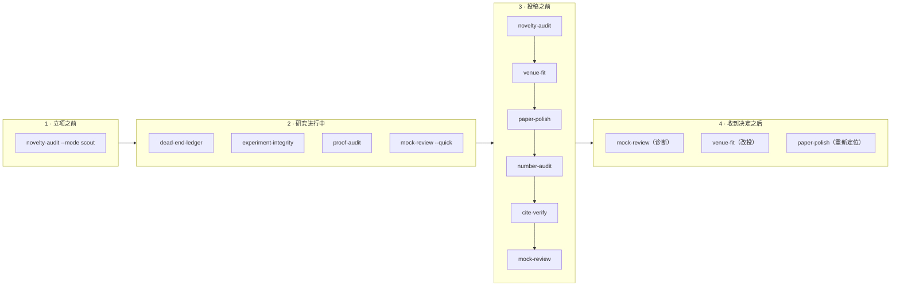
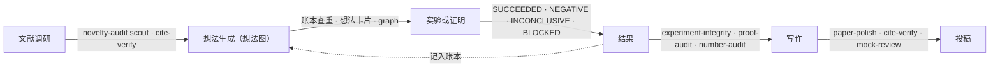

<div align="center">

# Science-Skill

**一组 Claude Code 技能：赶在编辑和审稿人之前，抓出 AI 辅助科研中可以预见的错误。**

[](https://github.com/OIerYangJZ/Science-Skill/actions/workflows/tests.yml)
[](LICENSE)


[English](README.md) · **简体中文**

[快速上手](#快速上手) · [能抓到什么](#能抓到什么) · [真实案例](#真实案例) · [技能一览](#技能一览) · [技能详解](#技能详解) · [流水线](#在自动科研流水线中作为关卡使用) · [常见问题](#常见问题)

</div>

---

## 为什么需要它

AI 助手已经参与到论文的写作、分析和核查之中。它出错的方式是可以预见的，而每种错误都有代价：被 desk reject、错误的数字印进论文、编造的参考文献、在别人早已发表的想法上花掉几个月。

| 当 AI 助手…… | ……常出的问题 | 技能 |
|---|---|---|
| 润色稿件时 | 层层加限定，直到贡献被埋没；让它写得有力些，又会过度宣称 | [`paper-polish`](#paper-polish) |
| 在数据、代码和正文之间搬运数字时 | 数字与数据脱节，统计量前后对不上 | [`number-audit`](#number-audit) |
| 编写和修改分析代码时 | 代码不再实现论文描述的设计，评测方式本身制造出结果 | [`experiment-integrity`](#experiment-integrity) |
| 撰写或润色长证明时 | 有些步骤从未写出或从未被检查；求解器的结果被当成公式本身的证明 | [`proof-audit`](#proof-audit) |
| 整理参考文献时 | 元数据错误、文献凭空编造、引用并不支撑所在的句子 | [`cite-verify`](#cite-verify) |
| 检索文献时 | 只找到支持"我们是新的"的文献，漏掉可能推翻新颖性的文献 | [`novelty-audit`](#novelty-audit) |
| 建议投稿去向时 | 凭记忆作答，费用、规则和截止日期都已过时 | [`venue-fit`](#venue-fit) |
| 写模拟审稿意见时 | 复述作者自己的笔记，声称的"错误"从未被核实 | [`mock-review`](#mock-review) |
| 汇报难题的进展时 | 比证据所支持的更乐观，还反复尝试已经失败的路线 | [`dead-end-ledger`](#dead-end-ledger) |

每个技能都是一份由 Claude Code 执行的**书面流程**，配有只用 **Python 标准库**实现的测量、追溯和核验脚本，让结论以证据为依据，而不取决于模型的语气。每个技能都是在相应问题于真实项目中发生之后编写的，见 [FAILURE_MODES.md](FAILURE_MODES.md)。

这些技能**不限学科**：支持 LaTeX、Word、Markdown、纯文本和 PDF 稿件；在证据等级、报告规范和因果措辞等关键之处，会区别对待理论、实验、观察性、计算、定性和综述等不同类型的研究。

## 目录

- [为什么需要它](#为什么需要它)
- [能抓到什么](#能抓到什么)
- [真实案例](#真实案例)
- [快速上手](#快速上手)
- [技能在研究流程中的位置](#技能在研究流程中的位置)
- [技能一览](#技能一览)
- [设计原则](#设计原则)
- [安装](#安装)
- [一次技能运行是怎样的](#一次技能运行是怎样的)
- [技能详解](#技能详解)：[paper-polish](#paper-polish) · [number-audit](#number-audit) · [experiment-integrity](#experiment-integrity) · [proof-audit](#proof-audit) · [cite-verify](#cite-verify) · [novelty-audit](#novelty-audit) · [venue-fit](#venue-fit) · [mock-review](#mock-review) · [dead-end-ledger](#dead-end-ledger)
- [不用 Claude Code 的快捷提示词](#不用-claude-code-的快捷提示词)
- [在自动科研流水线中作为关卡使用](#在自动科研流水线中作为关卡使用)
- [命令行工具](#命令行工具) · [支持的输入](#支持的输入) · [数据来源与隐私](#数据来源与隐私)
- [局限](#局限) · [常见问题](#常见问题) · [相关项目](#相关项目)
- [仓库结构](#仓库结构) · [测试](#测试) · [参与贡献](#参与贡献) · [引用](#引用) · [许可证](#许可证)

## 能抓到什么

下面的示例都节选自附带脚本在 [`tests/fixtures/`](tests/fixtures/) 合成样例上的真实输出；参考文献一例是在一个小测试文件上运行的。每个示例都能在几秒内复现（命令见[快速上手](#快速上手)）。

### 防御性的摘要 → `paper-polish`

> *Although many methods exist, we attempt to shed light on the problem. It is worth noting that results may potentially vary. We do not claim that the method is general. We first tried a linear model. Then we ran a series of experiments. Our method may not generalize. In some cases the approach is limited.*

```text
$ python3 skills/paper-polish/scripts/hedge_scan.py tests/fixtures/hedge.md
| hedge.md:5 | D2  | Although                  | concession before the result
| hedge.md:5 | D4  | we attempt · shed light   | diluted contribution
| hedge.md:5 | D12 | It is worth noting        | filler
| hedge.md:5 | D5  | may potentially           | modal hedge
| hedge.md:5 | D1  | We do not claim           | disclaimer
| hedge.md:5 | D15 | We first tried · Then we  | work-report narrative
| hedge.md:5 | D16 | may not generalize        | local weakness stated as global
defensive hits / 100 words: 15.66
```

扫描只能找出症状。技能随后会把你的摘要与目标期刊的近期论文对比，再依据 claim ledger 重写，思路大致如下：

| 修改前 | 修改后 |
|---|---|
| "Our method may not generalize, and in some cases its accuracy is limited." | "Accuracy holds within 2 points across the four adult cohorts; in the pediatric cohort (n = 212) it drops by 9 points, which we trace to a different age distribution of the main predictor." |

弱点仍然留在论文里，只是现在说得精确，并且写在实际观察到它的地方。

### 对不上的统计量 → `number-audit`

```text
$ python3 skills/number-audit/scripts/number_audit.py stats tests/fixtures/stats.md --out /tmp/demo
12 reported results recognised; 7 need attention.

status        test       reported                                why
INCONSISTENT  t          t(28) = 2.20, p = .004                  recomputed p = 0.036
CHECK         GRIM mean  M = 3.48, SD = 1.20, n = 15             no integer total over n = 15 gives this mean
CHECK         GRIM %     33.3% (n = 28)                          no k/28 rounds to 33.3%
CHECK         SD bound   85.2% ± 60.1%                           SD above the maximum possible (35.5) on [0, 100]
INCONSISTENT  delta      from 200 ms to 150 ms, a 40% reduction  200 → 150 is a 25% reduction
CHECK         overlap    outperforms (81.2 ± 2.1 vs 80.4 ± 1.9)  intervals overlap: report a test
ok            t          t(40) = 2.10, p = .042
```

### 制造结果的代码 → `experiment-integrity`

```python
def run_case(mode, seed, p, rng):
    for k in range(10):
        if mode == "q4" and rng.random() < p:   # 只在一组里抽随机数：两组的随机流从此错位
            ...

def max_gap(angles):
    if len(angles) < 3:
        return 360                              # 哨兵值，可能被当成计算结果写进表格

def evaluate(model):
    scores = np.random.rand(10)                 # TODO replace with real evaluation
```

```text
$ python3 skills/experiment-integrity/scripts/integrity_scan.py tests/fixtures/integrity_proj
R1  model.py:17            random draw inside the if-condition; the number of draws depends on the other operands
S2  model.py:8             constant returned when len(angles) < 3: make sure it never reaches a table as if computed
X1  model.py:51            random numbers assigned to a result-like variable: placeholder data on a result path?
X2  model.py:47            metric-like function 'f1_macro' is never referenced
G1  qa/check_numbers.py:2  number checked by substring: '0.47' is found inside '10.47'
... 14 leads in 4 files
```

每条线索随后都要通过阅读代码路径或插桩重跑来确认或排除。确认的问题会附上修复前后的影响对比，并转成回归护栏。

### 自己证明自己的证明 → `proof-audit`

```text
$ python3 skills/proof-audit/scripts/proof_map.py tests/fixtures/proofs.tex --out /tmp/demo
- theorem thm:main (proofs.tex:16)
  - conjecture conj:H (proofs.tex:9) [CONDITION]
  - lemma lem:a (proofs.tex:10) [gaps 1]
    - lemma lem:b (proofs.tex:12) [gaps 1]
      - lemma lem:a (proofs.tex:10) ↺ cycle
- theorem thm:second (proofs.tex:17) [no proof]

undefined labels: eq:missing     gap phrases: "Clearly", "One can show", "a standard argument"
```

证明地图只告诉你该看哪里。技能随后建立证明义务账本，并让独立的子代理逐步检查每个证明。

### 有问题的参考文献 → `cite-verify`

```text
$ python3 -I skills/cite-verify/scripts/refcheck.py check refs.bib --all --out /tmp/demo
lecun2015    AUTHOR_MISSING_FROM_BIB  2 in bib vs 3 in record; missing: hinton
             YEAR_MISMATCH            bib 2016 | record 2015
             VOLUME_MISMATCH          bib 512 | record 521
vaswani2017  AUTHOR_MISSING_FROM_BIB  2 in bib vs 8 in record
fake2024     DOI_NOT_FOUND            10.1038/s41586-024-99999-9
             NOT_FOUND                no record by DOI, arXiv id or title; possibly fabricated
```

### 高估进展的账本 → `dead-end-ledger`

```text
$ python3 skills/dead-end-ledger/scripts/ledger.py graph tests/fixtures/ledger.md
## Problems (4)
- R6 depends on Z9, which is not in the ledger
- dependency cycle: R5 -> R6 -> R5
- R2 is VERIFIED but depends on T1 (OPEN): mark it CONDITIONAL(T1) or verify those first
- R3 relies on R4 (RETRACTED): re-check or retract it

## Ready to attempt (all dependencies VERIFIED)
- T2: extension to r=3
```

## 真实案例

[`examples/README.md`](examples/README.md) 记录了在作者自己的一篇理论稿件上运行的全过程。这篇稿件约有 65 个定理类结果，证明全部放在附录中，其中一个主定理依赖 SMT 求解器证书。这次运行用到了全部脚本、`/mock-review --quick` 和完整的 `proof-audit`，共 10 个子代理。公开的只有流程和汇总结果，稿件和具体发现都只留在作者本地。

| 层次 | 发现 |
|---|---|
| `/mock-review --quick` | 决定性的反对意见在于意义和定位（标题说得比定理更满），而不在数学；三条致命论点的事实部分都经主会话核实 |
| `proof-audit`（7 组逐步检查，外加求解器部分） | 检查了约 40 个结果和论断，没有 INVALID；多数只需修补，不改变定理陈述；一个主定理存在可补的 GAP，其中核心不等式只由求解器检查 |
| 脚本 | 库的修复大多来自参考文献检查：REVTeX 的 `\href` DOI、标题中的数学符号、作者名中的特殊字母，曾导致 57 条中 29 条被标出；修复后只剩 2 条，都是检索没命中的真实论文 |

这次运行还促成了一条流程规则：有个子代理自行安装了求解器包，所以审稿和审计的提示词现在明确禁止子代理安装软件。

## 快速上手

**1. 安装。** 需要 [Claude Code](https://claude.com/claude-code) 和 Python 3.10 或更高版本。

```bash
git clone https://github.com/OIerYangJZ/Science-Skill.git
cd Science-Skill
./install.sh                  # 把每个技能链接到 ~/.claude/skills/
python3 tests/run_tests.py    # 可选：约一秒，检查脚本能否在本机正常运行
```

**2. 使用技能。** 在论文所在目录新开一个 Claude Code 会话，输入例如：

```text
/number-audit main.tex --repo .
/paper-polish manuscript.docx "Nature Communications"
/mock-review . "Physical Review Letters" --quick
```

每个技能都按自己的流程执行，在需要你做决定的地方停下来，最后给出简短的汇报。

**3. 也可以不用 Claude Code，直接试试脚本：**

```bash
python3 skills/number-audit/scripts/number_audit.py stats tests/fixtures/stats.md --out /tmp/demo
python3 skills/paper-polish/scripts/hedge_scan.py tests/fixtures/hedge.md
python3 skills/dead-end-ledger/scripts/ledger.py graph tests/fixtures/ledger.md
```

## 技能在研究流程中的位置



- **立项之前：** 查一查这个想法是否已有人做过或正在做（`novelty-audit --mode scout`）。
- **研究进行中：** 维护一份如实的账本（`dead-end-ledger`）；代码稳定后审计代码（`experiment-integrity`）；证明在记为"已证明"之前先审计（`proof-audit`）；用低成本的方式检验某种表述（`mock-review --quick`）。
- **投稿之前：** `novelty-audit` → `venue-fit` → `paper-polish` → `number-audit` → `cite-verify` → `mock-review`；如果还没做过，再加上 `experiment-integrity` 或 `proof-audit`。
- **收到决定之后：** 诊断拒稿原因，选择下一个投稿去向，重新组织编辑会读的部分。

## 技能一览

| 技能 | 阶段 | 针对的失效模式 | 主要产出 |
|---|---|---|---|
| [`paper-polish`](#paper-polish) | 写作 | 防御性写作让编辑看不出新意，以及反方向的过度宣称 | 目标期刊范文调研；差距分析；claim ledger；重写的标题、摘要和引言；盲测编辑 |
| [`number-audit`](#number-audit) | 写作 | 数字与数据、代码脱节；误读工具约定；统计量对不上 | 数字清单；一致性线索；来源追溯；统计检查（p 值、GRIM、标准差上界、变化幅度算术）；让数字始终与数据绑定的护栏 |
| [`experiment-integrity`](#experiment-integrity) | 研究 | 代码没有实现所描述的设计；实验设计或评测方式制造出结果 | 设计声明台账；代码静态扫描；带前后对比的确认问题；回归护栏 |
| [`proof-audit`](#proof-audit) | 研究 | 证明中有步骤从未写出或从未被检查；把求解器的结果当成公式本身的证明 | 证明地图；证明义务账本与假设账本；独立的逐步检查；计算机辅助部分的可追溯性 |
| [`cite-verify`](#cite-verify) | 写作 | 参考文献元数据错误或编造；引用不支撑所在的句子 | 逐条与 Crossref、DataCite、arXiv、Europe PMC 核对；修正建议；论断支撑检查 |
| [`novelty-audit`](#novelty-audit) | 立项、写作 | 只检索支持新颖性的文献；投入之后才发现被抢先 | 用相邻领域术语重述的贡献；附日志的多源检索；判定；立项前查重与持续监测 |
| [`venue-fit`](#venue-fit) | 投稿 | 凭印象选投稿去向 | 相似工作发在哪里；期刊档案；附网址和核对日期的官方事实表；匹配度评估；投稿计划与日程 |
| [`mock-review`](#mock-review) | 投稿 | 模拟审稿不独立、不复核，稿件版本也不固定 | 隔离并锁定版本的审稿副本；独立报告；交叉讨论；核实；按优先级排序的联合报告；快速的致命论点模式 |
| [`dead-end-ledger`](#dead-end-ledger) | 研究 | 讨好式的进展汇报；反复尝试已经失败的路线 | 研究账本：分级的结果、路线、依赖关系和障碍；想法卡片；止损规则；格式检查与依赖图 |

## 设计原则

1. **证据先于措辞。** 主张的强度由证据的强度决定：定理写成已证明；观察性研究中的关联不写成因果；单次运行的结果不写成一般结论。
2. **标准来自范文。** 怎样才算写得好，以目标期刊同类型的近期论文为准，不照搬任何一个学科的习惯。学科规范要求的不确定性表述（关联措辞、置信区间、局限性段落）予以保留；针对贡献本身的防御性限定予以删除。
3. **从不覆盖原件。** 所有产出写入带日期的工作目录；稿件在 git 仓库中时，该目录会被排除在版本控制之外。代码修改以补丁形式提出，重跑都在副本里进行。
4. **独立核查。** 负责审稿、分析范文、核验证明或结果的子代理不读作者的笔记；它们的结论要经主会话核实后才会采用。
5. **模拟的判断如实标注。** 凡是"未找到"，都同时说明检索了什么、在哪里检索、何时检索。关于期刊和工具的事实，只取自官方来源或源代码，并注明核对日期。
6. **表述问题与实质问题分开。** 改写解决不了的问题会如实指出。
7. **高成本或对外的步骤先征得同意。** 耗时长或要付费的重跑，先估算，经你同意后才启动；不经询问，不会把任何内容发给外部模型服务商。
8. **语言。** 技能用你的语言交流、写报告；稿件文本保持原有的语言。

## 安装

**依赖**

| | |
|---|---|
| 必需 | [Claude Code](https://claude.com/claude-code)；Python 3.10 或更高版本（只用标准库，已在 Python 3.14 上测试） |
| 可选 | `pdftotext`（poppler），用于 PDF 稿件；GitHub CLI `gh`，用于 `novelty-audit` 中的代码仓库检索；`git`，用于 `mock-review` 打包 git 仓库 |
| 网络 | [数据来源与隐私](#数据来源与隐私)一节列出的公开学术接口 |

**作为个人技能安装**（推荐）：

```bash
git clone https://github.com/OIerYangJZ/Science-Skill.git
cd Science-Skill
./install.sh            # 把 skills/* 软链接到 ~/.claude/skills/
```

安装后新开一个 Claude Code 会话，即可用 `/<技能名>` 调用。软链接指向克隆下来的仓库，所以 `git pull` 之后，下一个会话就会生效。`./install.sh uninstall` 只移除该脚本创建的链接，已有的非链接目录永远不会被动到。想安装到别处，可以设置 `CLAUDE_SKILLS_DIR`。

**也可以作为插件**在单次会话中加载：

```bash
claude --plugin-dir /path/to/Science-Skill
```

此时技能名带命名空间，例如 `/science-skill:paper-polish`。两种方式任选其一，不要同时使用。

各脚本依赖共享的 `lib/` 目录，不要把单个技能目录单独复制到别处使用。

## 一次技能运行是怎样的

1. **调用：** 在项目目录（或其附近）启动的 Claude Code 会话中，输入 `/<技能名>` 加自由文本参数（路径、目标期刊、模式等）。当你的请求与某个技能的描述相符时（例如"帮我核对论文里的数字"），Claude Code 也可能自动选用它。
2. **按固定阶段执行：** 脚本给出线索，模型结合上下文阅读，需要独立性的工作交给子代理。
3. **在该由你决定的地方停下：** 重写前确认新意的表述、批准长时间或付费的重跑、把任何内容发送到外部服务、替换参考文献条目。
4. **产出写入带日期的工作目录：** 放在稿件旁边；在 git 仓库中会加入 `.git/info/exclude`。模拟审稿的副本放在仓库之外。
5. **最后用你的语言给出简短汇报：** 结论、文件路径、需要你决定的事项，以及没能检查的部分。

**审计结论由脚本算出，不由模型书写。** `proof-audit`、`mock-review`、`experiment-integrity` 和 `number-audit` 最后都要填一张发现账本，即一张 Markdown 表格，列为 `id | item | location | verdict | evidence | verified`。报告脚本根据账本生成报告：
- 记下日期、版本和稿件文件的 SHA-256；
- 统计各类判定的数量，推出总体判定，写出结论句；
- 把条目分组为：已确认的严重问题、需要关注的问题、未检查的条目、通过的条目。

严重判定（INVALID 或 GAP、经确认的审稿错误、经确认的完整性问题、数字不符）只有经主会话核实（`verified = yes`）才算数，否则报告标为**未定稿**。判定用词不在该技能的词表里，也会导致未定稿。技能不能说出计算报告里没有的结论。

| 报告脚本 | 账本 | 判定词 |
|---|---|---|
| `proof-audit/scripts/audit_report.py` | `verdicts.md` | VERIFIED、VERIFIED WITH FIXES、CONDITIONAL(…)、GAP、INVALID、NOT CHECKED |
| `mock-review/scripts/review_report.py`（`--pin PIN.json`） | `verification.md` | CONFIRMED、PARTIALLY CONFIRMED、REFUTED、NOT CHECKED |
| `experiment-integrity/scripts/integrity_report.py` | `findings.md`（另加一列 `tier`：T、S 或 R） | CONFIRMED、POSSIBLE、REFUTED、NOT CHECKED |
| `number-audit/scripts/numbers_report.py` | `ledger.md` | CONFIRMED、MISMATCH、STATS-INCONSISTENT、CONVENTION-ISSUE、SUPERSEDED-PARAMETER、ORPHAN、UNVERIFIABLE |

每个报告脚本都支持 `--lang en|zh`。退出码：没有已确认的严重问题时为 0，有已确认的严重问题时为 1，报告未定稿时为 2。

| 技能 | 工作目录 | 会改动原有文件吗？ |
|---|---|---|
| paper-polish | `polish/<日期>/` | 不会；新文本写入新文件 |
| number-audit | `number_audit/<日期>/`，以及稿件旁新建的 `guards.json` | 不会；修改以清单或补丁形式提出 |
| experiment-integrity | `integrity/<日期>/` | 不会；在副本中重跑，修复以补丁形式提出 |
| proof-audit | `proof_audit/<日期>/` | 不会 |
| cite-verify | `refcheck/<日期>/` | 不会；`corrected.bib` 只是建议 |
| novelty-audit | `novelty/<日期>/` | 不会 |
| venue-fit | `venue/<日期>/` | 不会 |
| mock-review | `~/mock_review/<名称>-<日期>/`（仓库之外） | 不会 |
| dead-end-ledger | 你指定的账本（如 `research/LEDGER.md`）及其笔记 | 只改账本和它所管理的笔记 |

一次 `number-audit` 运行结束后的目录示例：

```text
paper/
├── main.tex
├── guards.json                 # 每次构建时从数据源重算关键数字
└── number_audit/2026-10-29/
    ├── numbers.md / .json      # 每个数字及其位置和上下文
    ├── conflicts.md            # 同一符号两种取值；手抄的宏值
    ├── stats.md / .json        # 统计一致性
    ├── trace.md                # 每个数字的来源
    ├── ledger.md               # 出处表
    └── report.md               # 结论在前
```

---

## 技能详解

每个技能的说明采用相同的结构：概览卡片、调用方式、流程、产出、所用脚本和提示。

### paper-polish

> 让编辑一眼看到论文的新意和重要性，同时不过度宣称。

| | |
|---|---|
| **适用场景** | 即将投稿；被 desk reject 之后；怀疑 AI 润色把稿子写得过于保守 |
| **不适用** | 语法层面的小修改 |
| **读取** | `.tex`、`.docx`、`.md`、`.txt`、`.pdf`；如有拒稿信和审稿意见，一并读取 |
| **会停下来问你** | 目标期刊（没给时）；重写前的五句话新意主线；每一处改变主张强度或范围的地方 |
| **网络** | OpenAlex、Crossref、arXiv、Europe PMC（检索并获取范文） |

**调用**

```text
/paper-polish <稿件> "<目标期刊>" [--mode full|survey|rewrite|check]
/paper-polish manuscript.docx "The Lancet"
/paper-polish main.tex "Physical Review Letters" --mode survey
```

| 模式 | 执行内容 | 何时用 |
|---|---|---|
| `full`（默认） | 阶段 0–7 | 第一次润色这篇稿子 |
| `survey` | 阶段 0–4，只出差距报告 | 想先看诊断、暂不改写 |
| `rewrite` | 阶段 5–7，复用已有调研 | 调研已经做过 |
| `check` | 只做扫描和盲测编辑 | 投稿前最后检查 |

**流程**

1. **接收：** 目标期刊、研究类型（理论、实验、观察性、计算、定性、综述）、拒稿信。
2. **测量编辑会读的部分**（标题、摘要、引言、图 1 图注）：主结果首次出现的位置、限定语、因果措辞、缺少检验的 "significant"、流水账式叙述、把局部弱点写成整体局限、符号密度、图注长度。同时建立 claim ledger：每条主张及其证据等级。
3. **找范文：** 目标期刊中同类型、写得好的近期论文 15–30 篇（池 A），最近邻的前人工作 5–10 篇（池 B），期刊官方的编辑标准（池 C）。每篇范文都经 DOI、arXiv ID 或 PMID 核验。
4. **拆解范文：** 由不读你稿件的子代理并行拆解，涵盖研究问题、行文、叙事重心、摘要与引言结构。
5. **写 `survey_report.md`：** 把你的稿件与范文逐点对比，并把表述问题与需要新结果的问题分开。
6. **新意主线（novelty spine）：** 五句话，分别是结果、缺口、重要性、头条数字、适用范围。**在这里停下来请你确认。**
7. **重写到新文件。** 结果先行；动词强度跟证据走；每个实验先交代它回答的问题；弱点写在实际观察到的地方；每个数字都有出处记录。校准措辞绝不删除结果：失败的条件、预先设定的主要指标、必要的局限都会保留。
8. **盲测编辑：** 一个子代理在不知道哪个是新稿的情况下读 A、B 两版；另一个子代理专找过度宣称。两份结论都由主会话核实。

**产出**（`polish/<日期>/`）

| 文件 | 内容 |
|---|---|
| `scan_before.md` | 编辑会读部分的基线测量 |
| `claim_ledger.md` | 每条主张、它的证据，以及证据允许的措辞 |
| `exemplars/`、`exemplar_stats.md` | 获取的范文及从中测得的写作标准 |
| `survey_report.md` | 差距分析 |
| `abstract_intro.tex`（或稿件原格式） | 候选标题、重写的摘要和引言，可选 cover letter |
| `polish_notes.md` | 结构对比、数字出处、需要你确认的有意改动 |
| `blind/` | 盲测编辑与过度宣称审查 |

**脚本**

```bash
python3    skills/paper-polish/scripts/hedge_scan.py manuscript.docx
python3    skills/paper-polish/scripts/hedge_scan.py polish/*/exemplars/*.md --summary   # 统计范文的写作标准
python3 -I skills/paper-polish/scripts/exemplar_meta.py search '"T-count" AND "lower bound"' --venue "PRX Quantum" --from 2021
python3 -I skills/paper-polish/scripts/exemplar_meta.py fetch 10.7554/eLife.05224 PMID:25774601 2211.09133 --out exemplars --intro
```

<details>
<summary><b>hedge_scan 代码表</b></summary>

| 代码 | 模式 | 例子 |
|---|---|---|
| D1 | 免责声明、否定式的范围说明 | "We do not claim…"、"beyond the scope" |
| D2 | 结果之前先让步 | "Although many methods exist, …" |
| D4 | 稀释贡献 | "we attempt to"、"shed light on"、"a first step" |
| D5 | 情态限定 | "may potentially"、"to some extent" |
| D6 | 含糊的研究空白 | "remains largely unexplored"、"little is known" |
| D8 | 版本历史、内部标签 | "in the previous version" |
| D10 | 无主被动句 | "It is shown that…" |
| D12 | 填充语 | "It is worth noting that"、"Interestingly" |
| D13 | "不是 X 而是 Y"式框架 | "X is not only a Y" |
| D15 | 流水账式叙述 | "We first tried… Then we…" |
| D16 | 把局部弱点写成整体局限 | "our method may not generalize"、"in some cases the approach is limited" |
| O、OC、OS | 可能的过度宣称；因果措辞；没有检验的 "significant" | "novel"、"leads to"、"significantly" |
| S | 范围限定（只计数，本身不算问题） | "under assumption A" |

结构性问题（主结果被埋、贡献平铺罗列、图注变成范围讨论、基线不点名）要靠阅读判断。定义和改法见 [`defensive-patterns.md`](skills/paper-polish/references/defensive-patterns.md)。

</details>

**提示**
- 写作标准来自范文统计，所以目标期刊选得是否准确很重要。
- 学科规范要求的不确定性表述（关联措辞、置信区间）会被有意保留。
- 想在任意聊天助手里快速处理，可以用[快捷提示词](#不用-claude-code-的快捷提示词)。

### number-audit

> 审计稿件中的每个数字，再安装护栏，让数字不会再次漂移。

| | |
|---|---|
| **适用场景** | 分析定稿、即将投稿；每次重跑或更新数据之后；回复审稿意见之前 |
| **不适用** | 检查证明（`proof-audit`）；检查代码是否实现了方法（`experiment-integrity`） |
| **读取** | 任意支持格式的稿件；数据与代码目录 |
| **会停下来问你** | 长时间或付费的重算；把修改应用到稿件 |
| **网络** | 不需要 |

**调用**

```text
/number-audit <主稿> [<补充材料>] [--repo <数据与代码目录>] [--scope key|all]
/number-audit main.tex supplement.tex --repo .
/number-audit manuscript.docx --scope all
```

`key`（默认）只审计摘要、引言、结论、图注、表格和定理陈述中的数字；`all` 审计全部数字。

**流程**

1. **盘点**每个数字及其位置和上下文；标出同一符号的两种取值，以及手抄的数据宏值。
2. **一致性：** 摘要、引言、表格、图注和 cover letter 之间是否一致，包括舍入。
3. **统计一致性：** 由检验统计量重算 p 值；k/n 百分比；比值类指标的置信区间；GRIM（在这个 n 下，整数数据能否得出这个均值或百分比？）；有界量表上的标准差上界；声称的变化幅度与起止数值是否吻合；± 区间重叠却声称"优于"的比较。
4. **追溯**每个关键数字，找到生成它的数据或脚本。
5. **在副本中重算**，并对"最优""至多"类主张背后的参数做扫描。**长时间或付费的运行会先问你。**
6. **按源代码核对外部工具的约定：** 误差范数、平均方式、标准误类型等。
7. **参数有效性：** 正文已排除的取值，不能仍在驱动某张图或某个表。
8. **安装护栏**，然后**写报告**。

**产出**（`number_audit/<日期>/`）：`numbers.md` / `.json`、`conflicts.md`、`stats.md` / `.json`、`trace.md`、`ledger.md`（出处表）、`report.md`；另有稿件旁的 `guards.json`。

**脚本**

```bash
N=skills/number-audit/scripts/number_audit.py
python3 $N extract main.tex supplement.tex --out number_audit/today      # 数字清单 + conflicts.md
python3 $N stats manuscript.docx --out number_audit/today                 # p 值、k/n 百分比、置信区间、GRIM、标准差上界、变化幅度
python3 $N stats survey.docx --out number_audit/today --bounds 1,7 --items 4   # 4 个条目、每条 1-7 分的量表
python3 $N trace number_audit/today/numbers.json --repo . --regions abstract,introduction,caption,table
python3 $N guard-init number_audit/today/numbers.json --out guards.json  # 然后填写 "source" 和 "locator"
python3 $N guard-check guards.json                                        # 有问题时退出码为 1
python3 skills/number-audit/scripts/numbers_report.py number_audit/today/ledger.md --out number_audit/today/summary.md
```

<details>
<summary><b>统计检查详解</b></summary>

| 检查 | 识别的写法 | 标出的问题 |
|---|---|---|
| 由统计量求 p | `t(23) = 2.45, p = .02`、`F(2, 45) = …`、`χ2(1) = …`、`r(46) = …`、`z = …` | p 落在舍入后统计量所允许的范围之外 |
| k of n | `12 of 40 (30%)` | 百分比不等于 k/n |
| 比值置信区间 | `OR = 1.8, 95% CI 1.2–2.7`（也包括 RR、HR） | 点估计偏离两端点的几何平均 |
| GRIM | `M = 3.48, n = 15`；`33.3% (n = 28)` | 没有任何整数总和能得出这个均值或百分比（多条目量表用 `--items k`） |
| 标准差上界 | 百分数、比例或 `--bounds lo,hi` 范围上的 `均值 ± 标准差` | 标准差超过该均值和范围下的 Bhatia–Davis 最大值 |
| 变化幅度 | "from A to B, a C% / C-fold / C-point change" | 按任何一种理解，C 都与 A、B 对不上 |
| 区间重叠 | "outperforms … (81.2 ± 2.1 vs 80.4 ± 1.9)" | 区间重叠却声称更好 |

每条 CHECK 都只是线索：GRIM 不通过，也可能是该变量的 n 不同，或得分本来就不是整数。当 n × 条目数大到报告的小数位已无法约束时，跳过 GRIM。

</details>

<details>
<summary><b>护栏详解</b></summary>

每个护栏条目把正文中显示的数字与它的来源绑定：

```json
{"id": "N0001", "display": "12.35%", "anchor": "the error rate",
 "source": "results/metrics.json", "locator": "metrics.err",
 "scale": 100, "decimals": 2, "thousands": false, "suffix": "%"}
```

locator 的写法：
- JSON 路径：`metrics.err` 或 `runs[0].auc`；
- CSV 单元格：`row=model:B;col=auc` 或 `row=3;col=auc`；
- 对文本文件做正则匹配：`re:Final loss: ([0-9.]+)`；
- 常数：`const:0.5`。

`guard-check` 用十进制 `ROUND_HALF_UP` 舍入重算每个值（二进制浮点数对 12.345 这类值的舍入并不一致），并在锚点附近查找，两侧都要求数字边界，所以 `0.47` 不会在 `10.47` 里被找到。每个条目的结果是以下之一：`PASS`；`FAIL`（附上实际找到的值）；`ANCHOR_MISSING`（句子被改写过）；`UNSOURCED`；`SOURCE_ERROR`；`STALE_PRESENT`（列在 `"stale"` 中的已更正旧值又出现了）。

可以把它接进 Makefile、pre-commit 钩子或 CI，放在分析之后、生成 PDF 之前。不要给运行时间这类每次都会变的数值设护栏。

</details>

### experiment-integrity

> 检查代码是否做了论文所说的事，以及设计本身是否在制造结果。

| | |
|---|---|
| **适用场景** | 自动检查全部通过后，想再做一轮对抗性检查；结果看起来过大或过于干净；任何带代码、模拟、测量或回测的论文投稿前 |
| **不适用** | 核对正文数字与数据（`number-audit`）；文献新颖性（`novelty-audit`） |
| **读取** | 稿件或报告；代码、配置、日志和结果文件 |
| **会停下来问你** | 长时间或付费的重跑；应用补丁 |
| **网络** | 不需要 |

**调用**

```text
/experiment-integrity <稿件或报告> <代码/数据目录> [--rounds 1|2]
/experiment-integrity paper.tex ./analysis --rounds 2
```

`--rounds 2` 会在修复之后再攻击一轮，针对设计本身和新加的护栏。在催生这个技能的案例里，第二轮的价值更大。

**流程**

1. **设计声明台账：** 每条方法学声明（样本量、种子、配对、数据划分、排除标准、搜索预算、检验方法），以及应当实现它的代码。
2. **静态扫描**（代码见下表）。
3. **核对声明与代码：** 阅读代码路径，并在副本中插桩运行，打印每组的种子、划分归属、兜底分支的触发次数、求解器状态等。
4. **按清单检查设计：** 随机性；兜底分支与哨兵值；样本量与尾部情况；数值计算；测量有效性；统计；图；以及评测有效性（真值由被测方法自己产生、自归一化的分数、描述了却从未计算的指标、占位数据、未经验证的 LLM 评委、选择性报告、一次改动多处的消融实验）。
5. **评估影响：** 对每个确认的问题，给出它所影响的每个数字在修复前后的数值。**长时间或付费重跑会先问你。**
6. **安装护栏：** 断言、测试和数字护栏，让重跑无法把问题带回来；每个调用点都要修。
7. **写报告。** 只有排除了无辜解释（并逐条列出）之后，问题才算"确认"。每条问题都注明可观察的程度：**T**（只有正文）、**S**（读过源代码）或 **R**（重跑过）。

**产出**（`integrity/<日期>/`）：`design_ledger.md`、`integrity_scan.md` / `.json`、`impact.md`、`findings.md`（账本）、`report.md`（由账本算出），以及建议的补丁。

**脚本**

```bash
python3 skills/experiment-integrity/scripts/integrity_scan.py ./analysis --out integrity/today
python3 skills/experiment-integrity/scripts/integrity_report.py integrity/today/findings.md --out integrity/today/report.md
```

<details>
<summary><b>扫描代码表</b></summary>

| 代码 | 模式 |
|---|---|
| S1 | 分母中的哨兵兜底（`x / max(d, 1e-12)`） |
| S2 | 在本应计算结果的函数里，边界分支返回常数（`if len(x) < 3: return 360`） |
| S3 | 吞掉异常（`except: pass`、`except: return 0`） |
| S4 | 用常数填补缺失值（`fillna(0)`、`nan_to_num`） |
| R1 | 条件里抽随机数（`if cond and rng.random() < p`） |
| R2 | 只在 `if` 的一个分支里抽随机数 |
| R3 | 每个文件的随机种子清单，包括 `SEEDS_A = [0, …]` 这类列表（用于比较各组） |
| P1 | 图中文字写死了数字 |
| L1 | 在划分训练/测试集之前就拟合了预处理（同一函数内，或在一个从不划分数据的函数里） |
| L2 | 用测试集上的分数挑选模型或超参数（`if auc > best`，而 `auc` 由 `y_test` 算出） |
| G1 | 检查脚本用子串判断数字（"0.47" 能在 "10.47" 里找到） |
| G2 | shell 陷阱（`grep -c … \|\| echo 0`；路径匹配缺少结尾定界） |
| X1 | 结果路径上的占位或合成数据（把随机数赋给 `scores`、`results` 等变量；`dummy`、`placeholder` 字符串；测试之外的 `TODO`） |
| X2 | 定义了却从未调用的指标函数（accuracy、F1、AUC、error 等） |

Python 用语法树扫描，R、Julia、MATLAB 和 shell 用正则扫描。每条命中都只是线索，要结合上下文阅读。完整清单见 [`checklist.md`](skills/experiment-integrity/references/checklist.md)。

</details>

### proof-audit

> 每一步都写出来，每个假设都看得见，每次计算都可追溯。

| | |
|---|---|
| **适用场景** | 理论结果即将在论文或研究账本中记为"已证明"；投稿含证明的论文之前；证明依赖计算时 |
| **不适用** | 核对数字与数据（`number-audit`）；核对代码与所描述的方法（`experiment-integrity`） |
| **读取** | LaTeX 源文件（正文与补充材料）；计算机辅助部分的代码和证书 |
| **会停下来问你** | 长时间计算 |
| **网络** | 不需要 |

**调用**

```text
/proof-audit main.tex supplement.tex
/proof-audit main.tex --results thm:main,lem:key        # 只审计这些结果及其全部依赖
/proof-audit main.tex --depth map                       # 只做结构和账本，不做逐步检查
```

**流程**

1. **接收：** 审计范围（默认是摘要和引言中陈述的结果）、深度、所依赖的外部结果。
2. **证明地图与证明义务账本：** 每个结果所依赖的每一步、在哪里得到证明、当前状态。
3. **假设账本：** 陈述的假设与实际用到的假设，包括被某个引理悄悄带进来的假设；条件链必须在结果出现的每个地方都写明。
4. **记号与适用范围：** 一个符号两种含义；定理的适用范围比摘要所说的窄。
5. **独立逐步检查：** 每个引理或组装步骤一个子代理，不读作者笔记，判定为 VALID、VALID WITH FIX、GAP 或 INVALID。凡是 GAP 和 INVALID，主会话都会复核。
6. **数值合理性检查：** 在临时目录中进行，舍入有影响时用精确算术。它能推翻某一步，但不能证明某一步。
7. **计算机辅助部分：** 送进求解器的每条约束都追溯到某个引理；要求独立的第二编码或精确证书（同一个公式换一个求解器，只验证了算术）；合理性查询；复现记录。**长时间计算会先问你。**
8. **有效性与常数**，然后**写报告**：每个结果的状态（VERIFIED、VERIFIED WITH FIXES、GAP、INVALID、CONDITIONAL on …）、最小修补方案，以及没有检查的部分。

**产出**（`proof_audit/<日期>/`）：`proof_map.md` / `.json`、`obligation_ledger.md`、`assumption_ledger.md`、`notation.md`、`verdicts.md`（账本）、`report.md`（先由账本算出，再加文字说明）。

**脚本**

```bash
python3 skills/proof-audit/scripts/proof_map.py main.tex supplement.tex --out proof_audit/today
python3 skills/proof-audit/scripts/audit_report.py proof_audit/today/verdicts.md --out proof_audit/today/report.md \
        --manuscript main.tex supplement.tex --version "$(git rev-parse --short HEAD)"
```

证明地图跟踪 `\ref`、`\cref`、`\eqref` 和 `\autoref`；能识别放在别处的证明（"Proof of Theorem~\ref{…}"、标题为 "Proof of …" 的小节、行内的 "Proof." 段落）；也会跟踪 `\externaldocument` 引入的标签。它报告依赖树、循环、没有证明的结果、条件链、未定义的标签、未被使用的引理、跳步用语、常数与有效性线索，以及以不同内容重复定义的宏。手写的引用（"Theorem 3"）它看不到；正文里提到某个结果也可能造成假的循环，所以每条依赖边都附有位置，便于核对。

<details>
<summary><b>真实运行的例子</b>（作者自己的理论稿件；只公开流程）</summary>

- **证明地图。** `proof_map.py` 梳理出约 65 个定理类结果，报告了 6 个循环和 7 条条件链。逐条核对后，全部是正文里的指引或比较，不是真的依赖。所以就这一点而言，摘要里说无条件的结果确实是无条件的。
- **逐步检查。** 7 个子代理按附录分组逐步检查，另有 1 个子代理审查求解器证书，effort 都设为 `high`。它们只读本组证明和被引结果的陈述，旧审稿意见和作者笔记都已排除。
- **复核。** 主会话复核了每一条 GAP。账本共 19 行，`audit_report.py` 算出：VERIFIED 3、VERIFIED WITH FIXES 8、CONDITIONAL 3、GAP 4（均已核实）、NOT CHECKED 1，**没有 INVALID**。
- **GAP 的内容。** 都可以补上，且不改任何定理陈述。其中一个主定理的核心不等式只由求解器检查，一个常数和求解器公式的一部分没有写出；另有一处"最优性"说法强于求解器运行所能支持的结论。
- **经验。**
  - effort 只能在启动时设定，所以逐步检查以 `high` 重新启动，以节省额度。用 TaskStop 暂停、再用 SendMessage 恢复，可以保留各子代理的进度。
  - 有三项检查被权限系统拦下，报告中列为"未检查"。

详见 [`examples/README.md`](examples/README.md)。

</details>

### cite-verify

> 分两层核验参考文献：元数据，以及被引文献是否真的说了引用句所归于它的内容。

| | |
|---|---|
| **适用场景** | 投稿前核对参考文献；核对 AI 或人工整理的文献清单 |
| **读取** | BibTeX；RIS（Zotero、EndNote、Mendeley）；`.docx`、`.pdf`、`.md`、`.txt` 或 LaTeX `thebibliography` 中任意引用格式的文献列表 |
| **会停下来问你** | 替换任何条目（修正只是建议） |
| **网络** | Crossref、DataCite、arXiv、Europe PMC |

**调用**

```text
/cite-verify references.bib --tex main.tex       # BibTeX + 稿件（只查被引用的条目）
/cite-verify library.ris                         # Zotero / EndNote / Mendeley 导出
/cite-verify manuscript.docx                     # 任意引用格式的文末参考文献
/cite-verify survey.md --claims                  # 文献清单，并做论断支撑检查
```

**流程**

1. **元数据核验。** 有 DOI 的查 Crossref，查不到再查 DataCite；有 arXiv 号的查 arXiv；自由文本条目做书目检索，标题按严格规则匹配。能发现作者、年份、卷号和页码错误，编造或查无此文的条目，已正式发表的预印本，撤稿与勘误，以及未定义或未使用的引用键。
2. **人工复核每条错误。** "查不到"不等于编造，报告中会写明检索了哪些来源。
3. **论断支撑。** 把正文中"把某个结果归于某篇文献"的句子（标为 **claim**）与原文核对，先查摘要、引言和结论中的句子。判定分为：支持、部分支持、不支持、无法核实。
4. **写报告**，分为必须修改与建议修改两部分。

**产出**（`refcheck/<日期>/`）：`report.md`、`results.json`、`corrected.bib`（仅为建议）、`contexts.md`、`claims.md`、`summary.md`。

**脚本**

```bash
R=skills/cite-verify/scripts/refcheck.py
python3 -I $R check references.bib --tex main.tex --out refcheck/today
python3 -I $R check library.ris --out refcheck/today
python3 -I $R check-list manuscript.docx --out refcheck/today
python3 -I $R contexts manuscript.docx --out refcheck/today       # 按文献列出引用它的句子
```

**提示**
- 书籍、学位论文、软件和档案常常没有被收录，这类条目需要人工查看。
- Word 中的上标引用编号在转换为文本时会丢失，识别不了。

<details>
<summary><b>真实运行的例子</b>（一篇 REVTeX 稿件，<code>thebibliography</code> 共 57 条）</summary>

第一次运行 `check-list` 时，57 条中有 29 条被标出，几乎全是误报。原因有四个：
- `\href{https://doi.org/…}{标题}` 让网址和标题粘在一起，DOI 被读错；
- 标题中的数学公式（`$z$-rotations`）和 Crossref 标题中的 MathML 使标题比对失败；
- 作者名中的 ø、ł 和 LaTeX 重音匹配不上；
- "See Supplemental Material" 这样的说明被当成参考文献检查。

修复后只剩 2 条，都是检索没命中的真实论文。这属于"查不到"，不等于"编造"。详见 [`examples/README.md`](examples/README.md)。

</details>

### novelty-audit

> 赶在审稿人之前，主动去证伪自己的新颖性。

| | |
|---|---|
| **适用场景** | 准备投稿；在写下 "first""novel""to our knowledge" 之前；审稿人质疑新颖性；立项之前（scout 模式） |
| **不适用** | 润色文字（`paper-polish`）；核对已有引用（`cite-verify`） |
| **读取** | 稿件，或对计划中结果的简短描述 |
| **会停下来问你** | 是否启动或调整方向（scout 模式） |
| **网络** | OpenAlex、arXiv、Europe PMC、Zenodo；装有 `gh` 时也会检索 GitHub |

**调用**

```text
/novelty-audit main.tex                                            # 审计模式
/novelty-audit main.tex --claims C1,C3                             # 只审计部分贡献
/novelty-audit "对某结果做独立的可认证复现" --mode scout              # 立项前查重
```

**审计模式流程**

1. **贡献卡片：** 把每条贡献拆成结果、技术、模型三部分。
2. **转写成相邻领域的说法。** 例如"计算血糖曲线下面积的新模型"，其实就是梯形法则。
3. **四个方向检索**，全部记入日志：关键词、反向引用、正向引用、近期预印本与同期工作。
4. **阅读：** 由一心想证明"这不是新的"的子代理阅读候选文献，主会话再逐项核实判定。
5. **写报告：** 每条贡献的判定、哪个领域会认为它是标准结果、必须补引的文献、建议的表述，以及需要什么新结果才能增强新颖性。

**scout 模式流程**

1. 把计划中的结果写成卡片。
2. 检索最近一年的文献，包括代码和数据存档。
3. 对每个计划中的结果给出判定（已有人做过 / 他人正在做 / 仍是空白），并列出差异化选项。
4. 建立监测清单，之后每次只报告新出现的条目。是否启动或调整方向，由你决定。

**产出**（`novelty/<日期>/`）：`cards.md`、`hits.md`、`search_log.md`、`report.md`；scout 模式另有 `novelty/watch_queries.txt`、`watch_state.json`、`watch_log.md`。

**脚本**

```bash
L=skills/novelty-audit/scripts/lit_graph.py
python3 -I $L search '"pass elimination" AND streaming' --log search_log.md
python3 -I $L search '"gut microbiome" AND "social network"' --db europepmc
python3 -I $L search '"single-cell" AND "foundation model"' --db zenodo --sort date
python3 -I $L citing 10.1006/jcss.1997.1545 --match '"lower bound" AND pass' --sort cited
python3 -I $L refs 2502.19526
python3 -I $L recent '"phase folding" AND "T-count"' --days 540
python3 -I $L watch --queries watch_queries.txt --state watch_state.json --days 90 --github
```

**检索提示**
- 短语加引号，用 AND 连接；不加引号的多个词会自动用 AND 连接。
- `--db` 可选：`openalex`（全学科，默认）、`europepmc`（PubMed、PMC、bioRxiv、medRxiv）、`arxiv`、`zenodo`、`all`。

### venue-fit

> 依据核实过的事实选择投稿去向，而不是凭记忆。

| | |
|---|---|
| **适用场景** | 选择或更换目标期刊；被拒之后；确定截止日期之前 |
| **不适用** | 准备投稿材料包；润色文字（`paper-polish`） |
| **读取** | 稿件；你的约束条件（预算、截止日期、开放获取要求、匿名要求） |
| **会停下来问你** | 最终决定；它从不代你投稿、付费或联系编辑 |
| **网络** | OpenAlex（筛选）；期刊官方网页（事实） |

**调用**

```text
/venue-fit main.tex
/venue-fit manuscript.docx "Nature Communications, PLOS Biology, eLife" --budget 3000 --deadline 2027-01-31
```

**流程**

1. **接收：** 研究类型、约束条件、投稿历史、新颖性判定。
2. **长名单：** 根据相似工作的发表去向，加上你的候选和可并行的低成本选项。
3. **期刊档案：** 筛出 3–6 个入围期刊。
4. **官方事实表：** 范围、编辑标准、文章类型与篇幅限制、评审方式、费用与减免、预印本政策、AI 与数据政策、一稿多投与转投规则、带时区的截止日期、匿名要求、是否进入正式出版物。每条事实都附网址、核对日期和原文摘录；查不到就写"未知"。
5. **附理由的匹配度评估：** 范围、门槛、格式、读者、费用、时间、政策兼容性、投稿历史、风险。
6. **计划：** 首选、备选、可并行的选项、截止日程（可选 `.ics`），以及投稿前要做的事。

**产出**（`venue/<日期>/`）：`factsheets.md`、`plan.md`，可选 `.ics` 日程文件。

**脚本**

```bash
V=skills/venue-fit/scripts/venue_fit.py
python3 -I $V neighbors --query '"T-count" AND "lower bound"' --from 2019 --types journal,conference
python3 -I $V neighbors --seed 10.1103/PRXQuantum.4.020323 --from 2019
python3 -I $V profile "Quantum" "PRX Quantum" 2470-0029
python3 -I $V factsheet "PRX Quantum" "Quantum" --out venue/today/factsheets.md
```

**提示：** OpenAlex 的期刊档案只用于筛选，费用、日期和政策必须到官网确认。测试中，OpenAlex 记录的某期刊创刊年份比实际早了几十年。

### mock-review

> 在锁定版本的稿件上，做一轮独立且可核实的模拟审稿。

| | |
|---|---|
| **适用场景** | 投稿前自查；诊断拒稿原因；准备回复审稿意见；检验某种表述（快速模式） |
| **读取** | 只读稿件目录的隔离副本（以 SHA-256 锁定版本），不含你的笔记 |
| **会停下来问你** | 副本中疑似私人笔记的文件；长时间重跑；任何跨模型审稿人 |
| **网络** | 期刊的审稿标准页面；报告规范的检查清单 |

**调用**

```text
/mock-review ./paper "BMJ" --roles clinical,statistics,reporting
/mock-review . "Physical Review Letters" --roles proofs,domain,reproducibility --editor
/mock-review ./paper "Nature Communications" --quick
```

| 模式 | 执行内容 | 何时用 |
|---|---|---|
| 完整（默认） | 2–4 个审稿方向、交叉讨论、核实、联合报告 | 投稿前；被拒之后 |
| `--quick` | 一份拒稿意见、一份辩护、核实 | 论文还在改动时；检验某种表述；判断是否值得做一轮完整审稿 |

**完整模式流程**

1. **接收**，包括抓取期刊官方的审稿标准。
2. **打包并锁定版本。** 在 git 仓库中只打包已跟踪的文件；未跟踪的笔记、`CLAUDE.md`、各类工作目录、`submission/` 和 `internal/` 都会排除。检查清单中是否有疑似私人笔记的文件。
3. **按论文类型选审稿方向：** 证明、领域专家、统计与研究设计、复现性、报告规范（CONSORT、STROBE、PRISMA、ARRIVE、TRIPOD 等，逐字抓取官方清单），可另加一位编辑。
4. **并行独立审稿。** 每位审稿人在自己的副本里复现数字，并列出读过的所有文件。
5. **交叉讨论**，附加在每份报告末尾；第一轮原文保持不变。
6. **主会话核实**审稿人声称的每个错误，先排除无辜解释。
7. **联合报告：** 按 P0/P1 排序，区分措辞问题与实质问题，并给出修订顺序。
8. **后续：** 按审稿意见改稿前，先运行 `check-pin`；第二轮审稿要换新的子代理。

**快速模式流程。** 一个新的子代理写出它能写出的最强拒稿意见：不超过 200 词，最多三条致命论点，每条附位置和证据。另一个新的子代理只依据论文本身逐条辩护：REBUTTED（附原文引用）、FIXABLE（附最小改动）或 STANDS。没有被干净驳倒的论点由主会话核实。即使论点被驳倒，也说明论文对这一点的回答对审稿人还不够显眼。

**跨模型审稿人（可选）。** 同一模型家族的审稿人有共同的盲区。如果你手头有其他模型，可以让其中一个审稿方向在那个模型上运行，使用相同的副本和提示词。把未发表的稿件发给另一家服务商，就等于与它共享了稿件，所以技能每次都会先征得你的同意。

**产出**（放在仓库之外：`~/mock_review/<名称>-<日期>/`）：`pack/`、`work-<方向>/`、`reports/`、`verification.md`（账本）、`verified_issues.md`（由账本算出）、`joint_report.md` 或 `quick_report.md`、`PIN.json`、`MANIFEST.md`。

**脚本**

```bash
P=skills/mock-review/scripts/review_pack.py
python3 $P pack --repo . --out ~/mock_review/paper-2026-10-29 --roles math,domain,stats --exclude "notes/*"
python3 $P check-pin ~/mock_review/paper-2026-10-29/PIN.json      # 稿件有改动时退出码为 1
python3 skills/mock-review/scripts/review_report.py ~/mock_review/paper-2026-10-29/verification.md \
        --out ~/mock_review/paper-2026-10-29/verified_issues.md --pin ~/mock_review/paper-2026-10-29/PIN.json
```

<details>
<summary><b>真实运行的例子</b>（作者自己的理论稿件；只公开流程）</summary>

- **打包并锁定版本。** `review_pack.py` 发现 15 个文件名像作者笔记的文件，其中有这篇稿子以前的审稿意见；排除后重新打包。
- **审稿标准。** 期刊的标准页面拒绝自动抓取（HTTP 403），改用搜索摘录，并标注"需上官网核对"。
- **攻击与辩护。** 攻击方用约 12 分钟写出三条致命论点；它读过的文件清单显示没有越出 pack。辩护方拆成 13 个子论点：6 个成立（多数论文已披露），4 个可通过改写修复，1 个被驳倒，2 个被部分驳倒。
- **核实与报告。** 主会话核对了每一处引文和数字，在 `verification.md` 中记了 13 行；`review_report.py` 算出：CONFIRMED 8、PARTIALLY CONFIRMED 4、REFUTED 1，已定稿。
- **决定性的反对意见**在于意义和定位，不在数学。
- **教训。** 辩护方曾为复现证书自行安装求解器包，之后提示词明确禁止子代理安装软件。

详见 [`examples/README.md`](examples/README.md)。

</details>

### dead-end-ledger

> 为长期研究目标维护一份如实的账本：什么已经确立，什么失败了、为什么，下一步做什么。

| | |
|---|---|
| **适用场景** | 用数周或数月推进同一个目标（开放问题、必须做成的实验、要提升的指标、要检验的假设）；每当你让助手"继续推进"或"汇报进展"时 |
| **读写** | 账本（如 `research/LEDGER.md`）及其指向的笔记 |
| **会停下来问你** | 止损规则被触发时；迁移已有的交接文档时 |
| **网络** | 不需要 |

**调用**

```text
/dead-end-ledger research/LEDGER.md init      # 新建，或迁移已有的交接文档
/dead-end-ledger research/LEDGER.md before    # 尝试新想法前：查重并填写想法卡片
/dead-end-ledger research/LEDGER.md record    # 一次工作结束后更新
/dead-end-ledger research/LEDGER.md report    # 根据账本汇报进展
```

**账本的内容**

| 部分 | 内容 |
|---|---|
| 状态行 | 一句带日期的话：什么已经确立，什么还没有 |
| 1. 结果 | 每个结果的状态、依赖、证据和核验人 |
| 2. 数据与数值证据 | 测试了什么、覆盖的范围或样本、结论 |
| 3. 开放目标 | 按可行性排序，附依赖和障碍 |
| 4. 已试路线 | 结果、止于何处、证据，以及什么条件下才值得重开 |
| 5. 障碍 | 每个障碍及撞上它的路线 |
| 6. 止损规则 | 预算、何时停止或转向、复查日期 |
| 7. 日志 | 每次工作一行 |

| 状态词 | |
|---|---|
| 结果 | VERIFIED（经独立核验）、UNVERIFIED、CONDITIONAL(H)、PRELIMINARY、NEGATIVE、RETRACTED |
| 路线 | FAILED（想法本身行不通）、BLOCKED（没能执行：算力、bug、权限、时间；不构成否定这个想法的证据）、INCONCLUSIVE（执行了，但结果无法判定）、PARTIAL、SUPERSEDED、IN-PROGRESS、SUCCEEDED |

也接受各领域的写法：PROVED-REVIEWED、REPLICATED、HEURISTIC、NULL；TECH-FAIL、ERROR、STALLED 按 BLOCKED 处理；MIXED、UNDECIDED 按 INCONCLUSIVE 处理。

**它执行的规则**
- 每条新路线开始前，先在账本中查找类似的失败路线，并填写一张带可证伪成功标准的想法卡片。如果新路线与某条失败路线相似，又说不清差别在哪，就不尝试。
- 结果写明自己依赖哪些条目。只有上游全部 VERIFIED，结果才能是 VERIFIED；一旦某个节点被撤回或被否定，建立在它之上的所有条目都会被标出。
- 结果经独立核验（证明审阅、实验复现、他人重跑）之后才能升级，并记录核验人和日期。
- 进展汇报只说账本支持的内容。主要路线都已失败时，就如实说明，而不是拿出一个看起来像成功的东西。

**脚本**

```bash
G=skills/dead-end-ledger/scripts/ledger.py
python3 $G init research/LEDGER.md --goal "把界从 a 无条件地提升到 b"
python3 $G search research/LEDGER.md "use a sieve over the fibration" --notes research/notes
python3 $G card --id X7 --out research/notes/X7.md --ledger research/LEDGER.md   # 新路线开始前的想法卡片
python3 $G graph research/LEDGER.md                            # 依赖树、问题、可着手的目标；有问题时退出码为 1
python3 $G lint research/LEDGER.md --notes research/notes     # 格式、状态词、证据路径、依赖图问题；有问题时退出码为 1
python3 $G status research/LEDGER.md
```

---

## 不用 Claude Code 的快捷提示词

[`prompts/calibrated-writing-en.txt`](prompts/calibrated-writing-en.txt) 和 [`prompts/calibrated-writing-zh.txt`](prompts/calibrated-writing-zh.txt) 是给任意聊天助手用的简短修改指令，贴在稿件文本前面即可。十条规则：

1. 结果先行；最多一个头条数字，并给出比较对象。
2. 动词强度跟证据走：证明、发现、与……相关、提示。
3. 不添加免责声明、让步、含糊的限定或稀释贡献的说法。
4. 每个条件只说一次，紧挨着它所限定的结果。
5. 保留学科规范要求的限定。
6. 研究空白、比较基线和每个弱点都要说具体。
7. 实验先交代它回答的问题，而不是按做的先后顺序叙述。
8. 不删除任何证据。
9. 不编造：不添加原文没有支撑的引用、数字、新颖性主张或强词。
10. 最后列出所有改动过的论断，供作者确认。

它们是 `paper-polish` 的轻量子集：没有范文调研、没有 claim ledger，也没有盲测。

## 在自动科研流水线中作为关卡使用

循环执行文献调研、想法生成和实验的智能体流水线，会犯和人机交互时一样的错误，只是更快。这些技能可以作为各阶段之间的关卡：



| 流水线阶段 | 关卡 | 防止的问题 |
|---|---|---|
| 文献调研 | `novelty-audit --mode scout`；对智能体整理的每份文献清单运行 `cite-verify` | 想法早已有人做过；参考文献编造或张冠李戴 |
| 想法生成（想法图） | `dead-end-ledger`：每个新想法前 `search` 查重，填写带可证伪标准的想法卡片，用 "Depends on" 连边，用 `graph` 找可着手的目标，设定止损规则 | 重跑失败路线；想法建立在已撤回或未证明的结果上；无止境的循环 |
| 实验结果 | 路线状态：SUCCEEDED、NEGATIVE / FAILED、INCONCLUSIVE，以及用于技术故障的 BLOCKED | 把崩溃或超时当成否定想法的证据，或把无法判定的结果当成支持 |
| 结果计入之前 | 对代码运行 `experiment-integrity`；理论主张用 `proof-audit`；报告数值用 `number-audit` 护栏 | 由流水线自身的 bug、哨兵值、数据泄漏或未经检查的证明步骤产生的结果 |
| 写作与审稿 | `paper-polish`、`cite-verify`；每轮迭代用 `mock-review --quick`，投稿前做完整的 `mock-review` | 防御性或夸大的稿件；未经核实的审稿意见 |

**可由机器判定的关卡**（失败时退出码非零）：`number_audit.py guard-check`、`ledger.py lint`、`ledger.py graph`、`review_pack.py check-pin`，以及四个报告脚本（`audit_report.py`、`review_report.py`、`integrity_report.py`、`numbers_report.py`：有已确认的严重问题时为 1，报告未定稿时为 2）。其他脚本给出的是需要智能体或人去阅读的线索；`refcheck.py` 会写出 `results.json`，逐条列出 ERROR 和 WARN。在流水线中，同意规则依然有效：长时间或付费的运行，以及任何要发送到外部服务的内容，都需要用户批准。

## 命令行工具

| 脚本 | 子命令与选项 | 用途 |
|---|---|---|
| `paper-polish/scripts/hedge_scan.py` | 文件；`--summary`、`--json`、`--sections` | 标题、摘要、引言、结论和图注的指标与被标出的措辞；多个文件的分布 |
| `paper-polish/scripts/exemplar_meta.py` | `venue`、`search`、`fetch` | 查找范文；核验元数据；获取摘要和引言（arXiv 源码或 PMC XML；支持 DOI、arXiv ID、PMID） |
| `number-audit/scripts/number_audit.py` | `extract`、`stats`、`trace`、`guard-init`、`guard-check` | 数字清单；统计一致性（`--bounds`、`--items`）；来源追溯；护栏 |
| `experiment-integrity/scripts/integrity_scan.py` | 路径；`--out`、`--exclude` | 静态扫描哨兵值、随机性、数据泄漏、用测试集挑选、图、检查脚本、占位数据和未使用指标中的陷阱 |
| `proof-audit/scripts/proof_map.py` | `.tex` 文件；`--out` | 定理与证明地图，附依赖、跳步用语、常数和记号线索 |
| `cite-verify/scripts/refcheck.py` | `check`、`check-list`、`contexts` | BibTeX 与 RIS 核验；自由文本文献列表；按文献列出引用句 |
| `novelty-audit/scripts/lit_graph.py` | `resolve`、`search`、`citing`、`refs`、`recent`、`watch` | 在 OpenAlex、arXiv、Europe PMC 和 Zenodo 上检索；从 DOI、arXiv ID 或 PMID 出发的引用图；监测清单 |
| `venue-fit/scripts/venue_fit.py` | `neighbors`、`profile`、`factsheet` | 相似工作发在哪里；期刊档案；事实表模板 |
| `proof-audit/scripts/audit_report.py`、`mock-review/scripts/review_report.py`、`experiment-integrity/scripts/integrity_report.py`、`number-audit/scripts/numbers_report.py` | 账本；`--out`、`--lang`、`--manuscript`、`--version`（审稿另有 `--pin`） | 由发现账本计算报告；退出码 0 / 1 / 2 |
| `mock-review/scripts/review_pack.py` | `pack`、`check-pin` | 隔离并锁定版本的审稿副本；检测稿件改动 |
| `dead-end-ledger/scripts/ledger.py` | `init`、`search`、`card`、`graph`、`lint`、`status` | 建立账本、查重、想法卡片、依赖图、检查 |

每个脚本都可以用 `--help` 查看说明。会读取下载内容的脚本，请用 `python3 -I` 运行。

## 支持的输入

| 输入 | 格式 |
|---|---|
| 稿件 | `.tex`（跟随 `\input` / `\include`）、`.docx`、`.md`、`.txt`、`.pdf`（借助 `pdftotext`） |
| 章节识别 | LaTeX 章节命令；IMRaD 标题；编号标题和全大写标题；无标题引言（Nature 风格）；结构化摘要 |
| 参考文献 | BibTeX；RIS；任意引用格式的文本列表；LaTeX `thebibliography` |
| 引用上下文 | `\cite` 键；数字引用 `[n]`；作者–年份引用 |
| 统计量 | 正文中的 APA 风格报告（`t(23) = 2.45, p = .02`、`F(2, 45) = 3.21, p < .05`、`χ2(1) = 3.84, p = .05`、`r(46) = .32, p = .03`、`z = 1.96, p = .05`）；`k of n (x%)`；带 95% 置信区间的 OR / RR / HR；`M = 3.48, n = 15` 和 `x% (n = 28)`（GRIM）；`均值 ± 标准差`；"from A to B, a C% / C-fold / C-point change" |
| 证明 | LaTeX 定理类环境（包括 `\newtheorem` 和 `\declaretheorem` 声明的环境）、proof 环境、`\ref` 系列引用、xr 包的 `\externaldocument` |
| 代码（integrity 扫描） | Python（语法树分析）；R、Julia、MATLAB、shell（正则） |

## 数据来源与隐私

脚本只访问公开服务：[OpenAlex](https://openalex.org)、[Crossref](https://www.crossref.org)、[DataCite](https://datacite.org)、[arXiv](https://arxiv.org)、[Europe PMC](https://europepmc.org)（PubMed、PMC 全文、bioRxiv、medRxiv）和 [Zenodo](https://zenodo.org)；装有 GitHub CLI 时，`novelty-audit` 也可以调用它。发送的只有检索词、标识符和参考文献元数据，从不发送稿件，也不发送任何个人信息。

| 环境变量 | 用途 |
|---|---|
| `OPENALEX_API_KEY` | 不设置时，同一 IP 下的所有用户共用一个很小的 OpenAlex 每日额度；大量使用时建议申请免费的 key。 |
| `SCIENCE_SKILL_MAILTO` | 用于 Crossref 和 OpenAlex polite pool 的邮箱，脚本不会自动设置。 |
| `CLAUDE_SKILLS_DIR` | `install.sh` 放置链接的位置（默认 `~/.claude/skills`）。 |

其他行为：
- arXiv 请求有频率限制。重试后 arXiv 仍返回 HTTP 429 时，脚本在本次运行中跳过 arXiv，并给出提示。
- arXiv 的 LaTeX 源码只在内存中解析，不会写到磁盘，也不会被执行。
- 逐字引文和计量只取自接口返回的文本或源文件，不使用经模型概括的网页内容。

## 局限

- 扫描脚本只支持英文稿件；措辞词表和句子切分都是针对英文设计的。报告可以用任何语言。
- Word 文档中的上标引用编号在转换为文本时会丢失，需要人工检查。
- 统计检查只识别正文中 APA 风格的行内报告，表格中的统计量需要人工检查。
- 证明地图只读 LaTeX，而且只能看到以引用形式写出的依赖。子代理的逐步检查是仔细的阅读，不是形式化验证。
- integrity 扫描对 Python 是精确分析，对其他语言是近似匹配。它只能发现可疑模式，不能直接判定 bug；设计层面的问题要靠"声明与代码核对"和检查清单来发现。
- 不检索 Web of Science、Scopus、PsycINFO 等订阅数据库，这类检索会交给你完成。许多人文学科文献不在上述任何服务中。
- 模式扫描和来源追溯给出的是线索，不是结论；技能要求逐条结合上下文阅读。
- 模拟审稿和模拟编辑由模型完成。它们检验的是贡献能否被读出、主张是否有依据，不能预测编辑的决定。

## 常见问题

<details>
<summary><b>我的稿件会离开我的电脑吗？</b></summary>

脚本只向上面列出的公开服务发送检索词、标识符（DOI、arXiv ID、PMID）和参考文献元数据。Claude Code 读取你的文件，和在任何会话中一样。唯一可能把稿件发给其他服务商的功能，是 `mock-review` 中可选的跨模型审稿人，而且每次都要你批准后才会运行。

</details>

<details>
<summary><b>技能会改写我的论文或修改我的代码吗？</b></summary>

不会。每个技能都写到自己带日期的目录里：改写的文本放进新文件，代码修复以补丁形式提出，参考文献修正写进 `corrected.bib`，每一处改变主张强度或范围的地方都会列出来请你确认。唯一会被直接编辑的已有文件，是 `dead-end-ledger` 管理的研究账本及其笔记。

</details>

<details>
<summary><b>我的领域不是物理或计算机，也适用吗？</b></summary>

适用。证据等级、报告规范（CONSORT、STROBE、PRISMA、ARRIVE、TRIPOD、SRQR、COREQ 等）、因果措辞规则和统计检查，覆盖实验、临床、观察性、计算、定性和综述研究。写作标准从你目标期刊的范文中测得，不取自任何一个学科。本 README 中的部分命令示例来自作者自己的领域，技能本身并不依赖它们。

</details>

<details>
<summary><b>不用 Claude Code 能用吗？</b></summary>

脚本可以单独运行（见[命令行工具](#命令行工具)），[快捷提示词](#不用-claude-code-的快捷提示词)可以在任意聊天助手中使用。`SKILL.md` 是纯 Markdown 写的流程，其他智能体也能读，但只在 Claude Code 上测试过。

</details>

<details>
<summary><b>脚本标出了一处其实没问题的地方，这是 bug 吗？</b></summary>

脚本给出的是线索，技能要求逐条结合上下文阅读。命中也可能是合理的：比如一个在报告的运行中从未触发的兜底分支，或者一个基于另一个 n 的百分比。如果某个模式在普通文本上产生误报，欢迎提 issue 并附上最小示例，以便把它加进测试样例。

</details>

<details>
<summary><b>一次运行要多久？</b></summary>

脚本只需几秒到几分钟，主要慢在网络检索。带子代理的完整运行（范文调研、独立审稿、逐步检查）是一个较长的会话。想快一些，可以用 `paper-polish --mode check`、`mock-review --quick` 或 `proof-audit --depth map`。

</details>

<details>
<summary><b>它能代替同行评审或保证录用吗？</b></summary>

不能。它的作用是清除可以避免的问题，让审稿人把注意力放在实质内容上。每份报告都会把模拟的判断标注出来。

</details>

## 相关项目

还有一些开源项目在处理相邻的问题，其中几个规模更大、自动化程度更高。Science-Skill 的范围更窄：每个技能只针对一种在实践中观察到的失效模式，附带的是做测量或核验的脚本而不只是指令，并且不限学科。

| 项目 | 是什么 | Science-Skill 的不同之处 |
|---|---|---|
| [ARIS (Auto-Research-In-Sleep)](https://github.com/wanshuiyin/Auto-claude-code-research-in-sleep) | 面向自主机器学习研究的 Markdown 技能：跨模型审稿循环、想法发现、实验自动化 | Science-Skill 可以作为这类循环中的核验关卡（[见上文](#在自动科研流水线中作为关卡使用)） |
| [Anti-Autoresearch](https://github.com/wanshuiyin/Anti-Autoresearch) | 站在审稿人一侧，对自动科研产出的论文做诚信取证，给出确定性的判定 | 站在作者一侧、在投稿前使用，并把确认的问题转成修复和护栏 |
| [anti-defensive-writing-Skill](https://github.com/Adkid-Zephyr/anti-defensive-writing-Skill)、[anti-defensive-writing](https://github.com/Kiterlin/anti-defensive-writing) | 针对防御性学术写作的写作原则和提示词包 | `paper-polish` 以目标期刊的范文和 claim ledger 为校准依据，同时防止矫枉过正、走向过度宣称；`prompts/` 是轻量版本 |
| [K-Dense scientific agent skills](https://github.com/K-Dense-AI/scientific-agent-skills) | 一个大型技能库，让智能体能使用科研工具、数据库和分析方法 | 它帮助智能体做科研，Science-Skill 核查智能体的产出，两者互补 |
| [academic-research-skills](https://github.com/Imbad0202/academic-research-skills) | 面向 Claude Code 的"研究 → 写作 → 审稿 → 修改 → 定稿"工作流套件 | 不是工作流，而是一组可以插入任何工作流任一阶段的检查 |

## 仓库结构

```text
Science-Skill/
├── skills/
│   └── <name>/
│       ├── SKILL.md            Claude Code 执行的流程
│       ├── references/         细则、检查清单、模板和示例
│       └── scripts/            可单独运行的脚本
├── lib/                        共享模块：文档读取、学术接口、BibTeX/RIS、统计
├── prompts/                    不用 Claude Code 时使用的校准写作提示词
├── examples/README.md          真实稿件的运行案例（只公开流程）
├── tests/
│   ├── run_tests.py            回归测试
│   └── fixtures/               预埋错误的合成样例
├── templates/SKILL_TEMPLATE.md 新技能模板
├── FAILURE_MODES.md            已观察到的失效模式和候选技能
├── install.sh                  以软链接方式安装技能
├── CITATION.cff                引用元数据
├── .github/workflows/tests.yml 持续集成
└── .claude-plugin/plugin.json  插件清单
```

## 测试

```bash
python3 tests/run_tests.py            # 离线、结果确定，约一秒
python3 tests/run_tests.py --online   # 另外查询 Crossref、OpenAlex 和 arXiv
python3 tests/run_tests.py -v         # 详细输出
```

每次推送和 pull request，GitHub Actions 都会运行离线测试：Linux 上覆盖 Python 3.10–3.14，macOS 上覆盖 Python 3.14。联网测试按需运行：手动启动 workflow 并勾选 `online` 即可。

[`tests/fixtures/`](tests/fixtures/) 中的样例都是合成的，并预埋了错误：不可能出现的均值、超出上界的标准差、算错的百分比变化、与统计量不符的 p 值、防御性措辞、条件里的随机数抽取、返回哨兵值的分支、占位数据、账本中的循环依赖、循环证明、被撤回的依赖，以及一条编造的参考文献。每个测试都检查预埋的错误被报告出来，而旁边的正确对照没有被误报。另有测试固定了脚本在[真实案例](#真实案例)中必须找到的问题，并检查仓库约定：每个技能的 frontmatter、两份 README 中的说明，以及 `FAILURE_MODES.md` 中的登记。

## 参与贡献

欢迎提交新的失效模式、其他学科的案例，以及误报报告。

1. **先记录失效模式：** 在 [FAILURE_MODES.md](FAILURE_MODES.md) 中写下症状和观察到的证据。新技能应当针对实际发生过的问题；该文件也列出了已观察到、但尚未编写的候选技能。
2. **编写技能：** 以 [templates/SKILL_TEMPLATE.md](templates/SKILL_TEMPLATE.md) 为模板，用英文编写，按需添加 `references/` 和 `scripts/`。脚本只用标准库，通过 `os.path.realpath(__file__)` 定位 `lib/`。description 不超过 1024 个字符。
3. **加入带预埋错误的样例：** 放进 `tests/`，然后运行 `python3 tests/run_tests.py`。持续集成会在 Python 3.10–3.14 上运行同样的测试。
4. **写文档：** 在两份 README（[README.md](README.md) 和本文件）中都加上说明。
5. **案例保持匿名：** 不包含未发表的结果、稿件细节或人名。
6. 运行 `./install.sh`，在新会话中测试。

## 引用

如果 Science-Skill 对你的工作有帮助，欢迎引用。GitHub 页面上的 "Cite this repository" 按钮读取的是 [`CITATION.cff`](CITATION.cff)；BibTeX 格式如下：

```bibtex
@software{science_skill,
  title   = {Science-Skill: Claude Code skills against the failure modes of AI-assisted research},
  author  = {{OIerYangJZ}},
  year    = {2026},
  version = {0.4.0},
  url     = {https://github.com/OIerYangJZ/Science-Skill},
  license = {MIT}
}
```

## 许可证

[MIT](LICENSE)。
