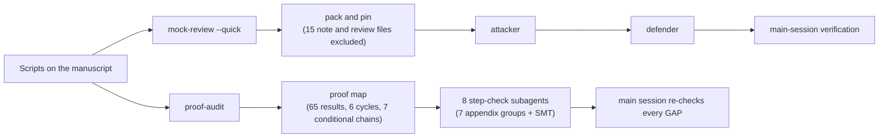

# Case study: auditing a real theory manuscript

This page records how the library ran on one of the author's own manuscripts, end to end. It covers the process and aggregate results only. By the author's choice, the manuscript, its venue history and the specific findings stay private. The full reports were kept on the author's machine, outside every repository.

| | |
|---|---|
| Manuscript | A mathematical manuscript with about 65 theorem-like results (main text, appendices with all proofs, and a supplement), LaTeX, about 2,000 lines; one main theorem uses an SMT-solver certificate; scripts and data are in a public repository |
| Run | 2026-10-29; Claude Code; 1 main session and 10 subagents (8 of them restarted once) |
| Skills | all scripts; `mock-review --quick`; `proof-audit` at full depth |

## What ran

1. **Scripts.** `hedge_scan`, `number_audit` (extract, stats, trace), `integrity_scan` on the scripts and certificates, `proof_map`, and `refcheck` on the reference lists. They took seconds, except the online reference check.
2. **`mock-review --quick`.**
   - **Pack and pin.** The first pack flagged 15 files whose names looked like notes, among them earlier reviews of this manuscript. They were excluded and the manuscript was repacked.
   - **Attack.** One fresh subagent wrote three kill arguments, about 12 minutes. Its list of files read showed that it stayed inside the pack.
   - **Defence.** A second fresh subagent answered every sub-claim, checked the external papers the memo cited, and reproduced the paper's numbers.
   - **Verification.** The main session checked every quotation and number both sides relied on.
   - **Criteria.** The venue's criteria pages refused automated fetching (HTTP 403), so the criteria came from search snippets and were marked "confirm on site", as the skill requires.
3. **`proof-audit`.**
   - **Proof map.** It reported 6 dependency cycles and 7 conditional chains. Checked edge by edge, all of them turned out to be prose pointers or comparisons, not real dependencies, so the results the abstract calls unconditional are unconditional in that respect.
   - **Step checks.** Seven step-check subagents, one per appendix group, plus one auditor of the computer-assisted part, each read only its proofs and the statements they cite.
   - **Re-check.** The main session re-checked every GAP before reporting it.

## Results, in aggregate

| | Outcome |
|---|---|
| Quick review | 3 kill arguments: significance for the venue, a title stronger than the theorems, and the novelty of the techniques. Of 13 sub-claims, the defender conceded 6 as standing (most already disclosed in the paper), marked 4 as fixable by rewriting, rebutted 1 and partly rebutted 2. Main-session verification confirmed the factual parts. The decisive objection was about significance and framing, not mathematics. |
| Proof audit | About 40 results and claims checked. **No INVALID.** Most were VALID WITH FIX with statements unchanged: missing hypotheses, a constant off by a factor of 2, a misdirected citation, a parameter range narrower than its use. One main theorem has GAPs that can be closed: an unstated discretization constant, an unspecified part of the solver formula, and a core inequality checked only by the solver. Two remarks claim slightly more than shown. |
| Computer-assisted part | Every solver constraint traced to the text. The second solver checked the same formula, so it verified the arithmetic only. A grid refutation scan was not run (blocked by permissions). |
| Scripts alone | No statistics to check (a theory paper). The proof map gave the leads above. The reference check was where most of the library fixes came from (below). |

## Reports computed from the ledgers

After this run, the audit skills compute their conclusions from findings ledgers (`lib/findings.py`). Applied to this run's ledgers:

| Ledger | Rows | Computed result |
|---|---|---|
| proof-audit `verdicts.md` | 19 | 3 VERIFIED, 8 VERIFIED WITH FIXES, 3 CONDITIONAL, 4 GAP (all verified by the main session), 1 NOT CHECKED; overall GAP; final; exit code 1 |
| mock-review `verification.md` | 13 | 8 CONFIRMED, 4 PARTIALLY CONFIRMED, 1 REFUTED; final; exit code 1 |

The computed proof-audit result is stricter than the first hand-written summary. That summary had called one theorem "verified with fixes" because its missing step was small, but the ledger records a missing step as GAP. Removing that kind of drift is the point of computing the conclusion.

## What the run changed in the library

| Gap found | Fix |
|---|---|
| REVTeX reference lists (`\href{https://doi.org/…}{Title}`) glued URL and title together: 29 of 57 references were flagged, almost all falsely | The URL and title are kept as separate words; a resolving DOI is trusted, and a differently worded title gives a warning, not "not found" |
| Math in titles (`$z$-rotations`) and MathML in Crossref titles defeated title matching | Math placeholders and markup are removed before matching |
| Author names with ø, ł or LaTeX accents failed to match | Names are transliterated before comparison |
| Notes such as "See Supplemental Material …" were checked as references | They are recognized and skipped |
| After the fixes: 2 errors out of 57 references, both real papers that the search did not find | (reported as "not found", which is not "fabricated") |
| A defender subagent installed a solver package on its own to reproduce a certificate | Review and audit prompts now forbid installing software; a missing package is reported as "not checked", and installing it is the user's decision |
| `X2` flagged `preprocess` as a metric function ("roc" inside the name) | Metric names are matched as whole tokens |

Each fix has a regression test in `tests/run_tests.py`.

## Lessons about running it

- **Subagent effort.** Effort is fixed when a subagent starts. The first batch of step checks was stopped and restarted at `high` to save quota. A later pause and resume kept each subagent's progress.
- **Permissions.** Three checks were blocked by the permission system: a numerical test, a grid scan, and a certificate that needed numpy. The reports list them under "not checked" instead of guessing.
- **Independence.** Excluding the earlier reviews and notes from the pack mattered. The repository contained them, and a reviewer reading them would have followed the authors' line of thought.
- **What the two layers saw.** The quick review found the framing problem, which no proof check would find. The proof audit found about 30 local fixes, which no kill memo would list.
