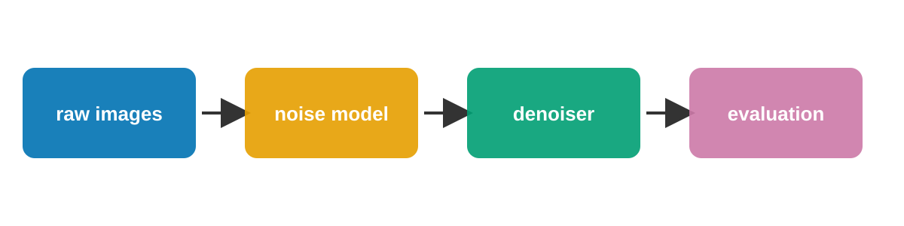
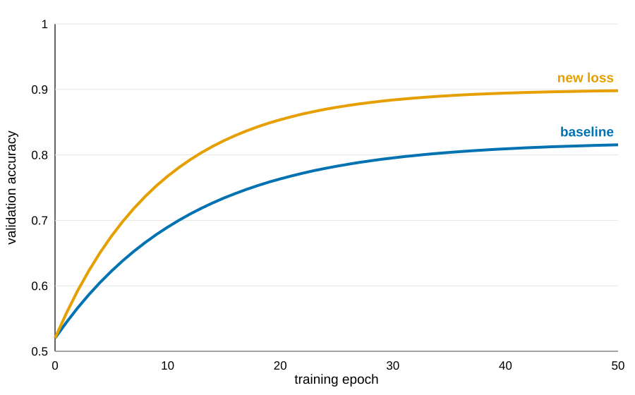
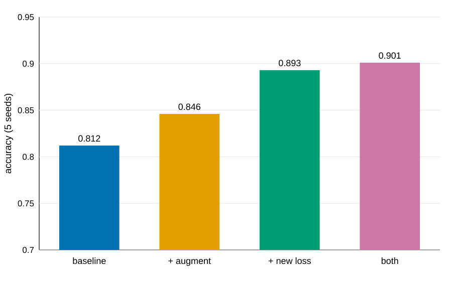

## Where things stand {time=1}
> The new loss raises validation accuracy from 0.812 to 0.893 over 5 seeds; the out-of-distribution gain is not established.

???
One sentence on the state of the project. The in-distribution result is verified by a labmate's re-run; the out-of-distribution result is still preliminary.

## Last time's plan, and what happened {time=1.5}
- {done R1} Re-run the new loss with 5 seeds
- {preliminary R2} Test on the out-of-distribution split
- {negative X1} Try a perceptual loss on VGG features
- {blocked X2} Train at 4x resolution (GPU quota)

???
Go through each planned item, including the two that did not work. X2 is blocked by compute, so it says nothing about the idea itself.

## The pipeline {time=0.5}

???
Thirty seconds: where the loss enters the pipeline.

## The new loss learns faster and plateaus higher {time=1.5}
{width=85%}

???
Both curves are means over 5 seeds. The gap opens after about 10 epochs and stays.

## Ablation {time=1.5}
:::
| Configuration | Accuracy (5 seeds) |
|---|---|
| baseline | 0.812 ± 0.006 |
| + augment | 0.846 ± 0.007 |
| + new loss | 0.893 ± 0.005 |
| both | 0.901 ± 0.008 |
:::

???
Most of the gain comes from the loss; augmentation adds a little on top. Standard deviations are over seeds, not over images.

## Out of distribution: not yet {time=1}
- {preliminary R2} 0.774 vs 0.769 for the baseline, within one SD
- The OOD split has only 5 seeds; I need more before saying anything

???
Do not over-read this: the difference is smaller than the seed-to-seed spread.

## Questions for the group {time=0.5}
1. Is a 4x-resolution run worth waiting for the quota, or should I drop it?
2. Which OOD benchmark would convince a reviewer?

???
Leave two to three minutes for discussion here.

## Plan until next meeting {time=0.5}
- {planned} 10 more seeds on the OOD split; success = gain larger than 2 SD
- {planned} Write up the in-distribution result as a short note

# Backup

## Training details {backup}
- Adam, learning rate 3e-4, batch 32, 50 epochs
- Same data split and seeds for every configuration
