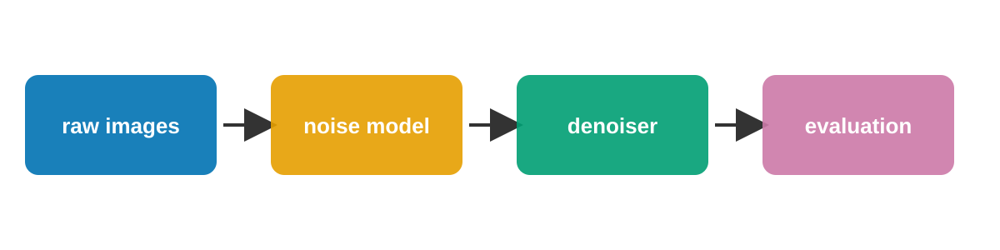
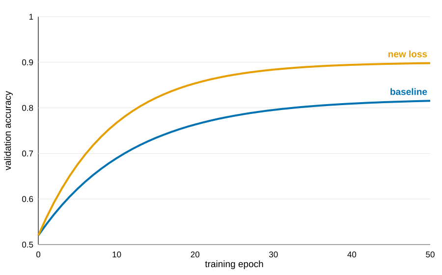
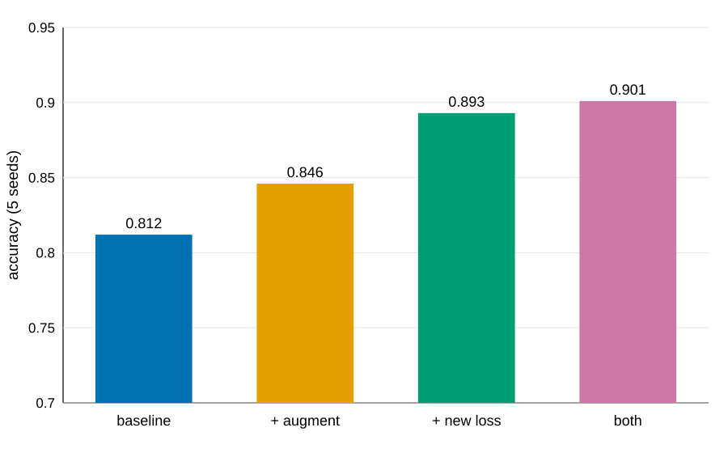

## Question {col=1}
- Low-light images carry signal-dependent noise that standard losses ignore.
- Does a loss that models this noise improve denoising accuracy?

## Approach {col=1}

- Same data split, seeds and training budget for every configuration
- Adam, learning rate 3e-4, batch 32, 50 epochs; 5 seeds each

## Learning curves {col=2}

- The gap opens after about 10 epochs and stays.

## Ablation {col=2}
| Configuration | Accuracy (5 seeds) |
|---|---|
| baseline | 0.812 ± 0.006 |
| + augment | 0.846 ± 0.007 |
| + new loss | 0.893 ± 0.005 |
| both | 0.901 ± 0.008 |

## Out of distribution {col=3}
- 0.774 vs 0.769 for the baseline: within one SD
- More seeds are needed before any claim

## Conclusions {col=3}
1. The new loss improves in-distribution accuracy (0.893 vs 0.812, 5 seeds).
2. Most of the gain comes from the loss, not from augmentation.
- Limitation: out-of-distribution benefit not shown.

## Key figure {center}

## References {footer}
Synthetic demo poster for Science-Skill; all data are invented.
